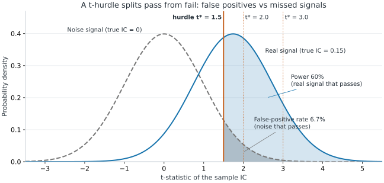
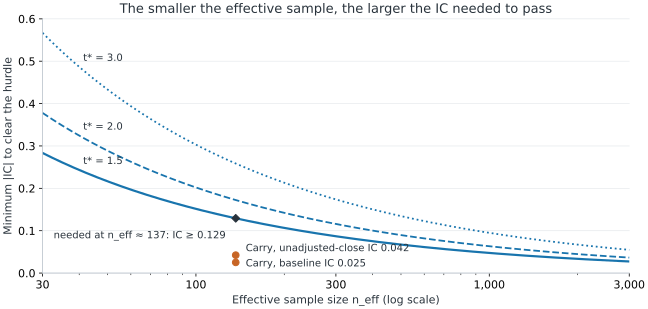
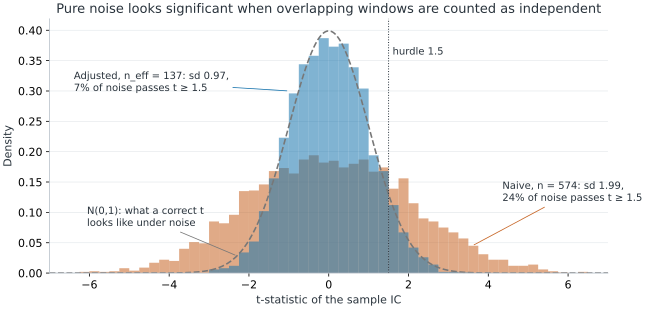
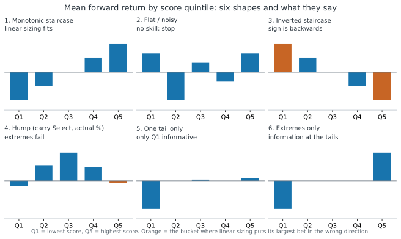

# Signal Evaluation

Signal evaluation asks three separate questions:

1. **Prediction:** does the score predict future returns out-of-sample?
2. **Tradability:** does a fixed sizing rule survive costs and drawdowns?
3. **Portfolio fit:** does it add Sharpe to the existing portfolio?

This chapter covers:

- the pre-registered protocol;
- the eight-step diagnostic checklist;
- the point-in-time data audit;
- debugging backtest-to-live failures.

**Prerequisites:** [[information-coefficient]], [[ic-significance]], [[icir-stability]], [[hit-rate]], [[fundamental-law-active-management]], [[signal-position-construction]], [[timing-curve-metrics]], [[turnover-cost-drag]], [[cross-validation-leakage]], [[multiple-testing]].

**Leads to:** [[grinold-alpha]], [[signal-to-weight]], [[carry-stock-bond-timing]], [[marginal-sharpe-improvement]].

**Sections:** [[timing-signal-evaluation]] · [[eval-directional-prediction]] · [[eval-statistical-significance]] · [[eval-directional-hit-rate]] · [[eval-sizing-monotonicity]] · [[eval-tradable-profitability]] · [[eval-turnover-costs]] · [[eval-temporal-stability]] · [[eval-correlation-redundancy]] · [[broker-research-replication]] · [[research-workflow]] · [[backtest-pitfalls]]


**Read the curves:** Over 520 weekly decisions on the same simulated market, a predictive score ($IC^{\mathrm{rank}} = +0.17$) traded at 5 bps compounds \$1 into **\$2.37** (blue), while pure noise ($IC^{\mathrm{rank}} = -0.01$) decays to **\$0.80** (grey). Trading the **exact same predictive score** at 50 bps decays to **\$0.63** (orange). Predictive skill and tradable profitability must be verified separately.

<details>
<summary>Simulation setup, equations and reproducibility</summary>

**Illustrative simulation (自己推理):** $T = 520$ weekly rebalance intervals (10 years), fixed seed `20261014` (`python scripts/generate_signal_figures.py`):

$$R_{t\to t+1}=0.025\left(0.18\,s_t+\sqrt{1-0.18^2}\,\varepsilon_{t+1}\right),\qquad w_t=\mathrm{clip}(s_t/2,-1,1),\qquad \Pi_{t+1}^{\mathrm{net}}=w_t R_{t\to t+1}-c|w_t-w_{t-1}|$$

**Variables:**

- $t=1,\dots,520$ weekly decision index
- $R_{t\to t+1}$ realised next-week spread return (weekly volatility $\sigma = 2.5\%$, annualised $\approx 18\%$)
- $s_t\sim\mathcal{N}(0,1)$ predictive score known at decision time $t$ (population correlation $0.18$, sample Rank IC $+0.166$)
- $\varepsilon_{t+1}\sim\mathcal{N}(0,1)$ independent forward return shock realised after decision $t$
- $w_t\in[-1,1]$ spread weight held over $[t, t+1]$ ($w_0 = 0$; noise benchmark replaces $s_t$ with independent $u_t\sim\mathcal{N}(0,1)$, sample Rank IC $-0.007$)
- $\Pi_{t+1}^{\mathrm{net}}$ weekly net strategy return after deducting one-way cost $c\in\{0, 5\text{ bps}, 50\text{ bps}\}$

</details>

<a id="timing-signal-evaluation"></a>

## Pre-Registration & The 8-Step Evaluation Checklist
<!-- section: timing-signal-evaluation | prerequisites: [information-coefficient, cross-validation-leakage, signal-position-construction, timing-curve-metrics] | related: [eval-directional-prediction, research-workflow, stock-bond-carry-case-study] | sources: [src-carry-course-notes, src-squarepoint-dqa-workbook] | tags: [checklist, signal-testing, diagnostics, pre-registration] -->

Never judge a candidate signal by a single backtest Sharpe ratio. Before viewing any return correlation, freeze the economic hypothesis, point-in-time data mapping, normalisation rule, forecast horizon $h$, and pass/kill thresholds, then evaluate the candidate across eight orthogonal diagnostics.

### The 8-part diagnostic checklist

| # | Diagnostic | Metric & Section | Institutional Benchmark | Why This Check Matters |
|---|---|---|---|---|
| **1** | **Directional skill** | Rank IC ([[eval-directional-prediction]]) | $0.03\text{–}0.08$ (Good)<br>$\le 0$ (Fail) · $> 0.10$ (Audit leakage) | Confirms raw monotonic forecast power before position sizing; $>0.10$ in liquid markets usually signals look-ahead leakage. |
| **2** | **Statistical significance** | Overlap-adjusted $t_{IC}$ ([[eval-statistical-significance]]) | $t \ge 1.5$ (macro timing)<br>$t \ge 2.0$ (single equity) / $\ge 3.0$ (multi-trial) | Deflates overlapping windows ($n_{\mathrm{eff}} = n/m$) so serial correlation does not manufacture fake significance. |
| **3** | **Directional accuracy** | Hit rate $HR$ ([[eval-directional-hit-rate]]) | $52\%\text{–}58\%$ (Realistic)<br>$\le 50\%$ (Coin flip) | Checks sign consistency; must be paired with payoff magnitude because high $HR$ with negative skew still loses money. |
| **4** | **Sizing monotonicity** | Quantile sort Q1–Q5 ([[eval-sizing-monotonicity]]) | Monotonic staircase $\bar R_1 < \dots < \bar R_5$<br>Humped / inverted Q5 (Fail) | Linear sizing ($w_t \propto s_t$) puts maximum capital on Q1/Q5; if Q5 loses money, conviction sizing blows up. |
| **5** | **Tradable profitability** | Timing curve & $\text{Max }DD$ ([[eval-tradable-profitability]]) | Positive $AR$, shallow/short $DD$<br>Multi-year underwater (Fail) | Simulates non-overlapping holding returns and checks whether drawdown depth and recovery duration fit the mandate. |
| **6** | **Execution survival** | Turnover $TO$ & Net $AR_{\mathrm{net}}$ ([[eval-turnover-costs]]) | $AR_{\mathrm{net}} > 0$ at realistic bps<br>Costs wipe out gross $AR$ (Fail) | Fast signals ($\rho_1 \approx 0.30$) churn portfolio weights and bleed alpha to bid-ask spread and market impact. |
| **7** | **Temporal stability** | Rolling 52w IC & Yearly IC ([[eval-temporal-stability]]) | $\text{ICIR} \ge 0.5$; $>70\%$ positive years<br>Single-year crisis windfall (Fail) | Verifies that performance is steady across regimes rather than a single lucky bet in 2008 or 2020. |
| **8** | **Portfolio increment** | Cross-signal $\rho$ & $\Delta SR$ ([[eval-correlation-redundancy]]) | $|\rho(s_{\mathrm{new}}, s_{\mathrm{book}})| \le 0.60$, $\Delta SR > 0$<br>$|\rho| > 0.60$ (Redundant) | Ensures the candidate adds independent breadth rather than doubling leverage on an existing factor. |

### Pre-registration discipline in code
Write the pass/kill gate into the evaluation script before running the backtest so the verdict is mechanical:
```python
verdict = "PASS to validate" if (rank_ic > 0 and t_stat_overlap >= 1.5) else "FAIL stop"
```
Modifying the data feed, lookback window, or forecast horizon after seeing `FAIL stop` is a **new trial** that must face the multiple-testing hurdle ($t \ge 3.0$, [[multiple-testing]]).

### Connections
- **Builds on:** [[information-coefficient]], [[cross-validation-leakage]], [[signal-position-construction]], [[timing-curve-metrics]].
- **Used by:** [[research-workflow]], [[carry-measurement-protocol]].

<a id="eval-directional-prediction"></a>

## Check 1: Directional Prediction (Rank IC)
<!-- section: eval-directional-prediction | prerequisites: [information-coefficient, timing-signal-evaluation] | related: [eval-statistical-significance, eval-directional-hit-rate, eval-sizing-monotonicity] | sources: [src-carry-course-notes, src-quant-finance-study-notes] | tags: [rank-ic, prediction, evaluation] -->

Check 1 evaluates whether higher signal scores $s_t$ predict higher forward returns $R_{t\to t+h}$ over the intended holding horizon using Spearman Rank IC (formula and properties in [[information-coefficient]]).

### Threshold rationale & failure modes
- **Target range ($IC \in [0.03, 0.08]$):** Financial returns are dominated by unforecastable shocks ($\varepsilon_{t+1}$). Even an IC of $0.04\text{–}0.06$ explains enough cross-sectional or temporal variation to generate a strong Sharpe ratio when combined with breadth or low turnover.
- **Zero or inverted ($IC \le 0$):** Gives an immediate stop under the registered orientation. Never flip the sign in-sample and claim a pass on the same dataset.
- **Too good to be true ($IC > 0.10$):** In liquid equities or macro futures, persistent IC above $0.10$ is a red flag for look-ahead bias (e.g. `shift(-h)` target misalignment, restatement leakage, or survivorship bias, [[broker-research-replication]]).

### Visual diagnostic: score vs forward-return scatter


**Read the plot:** Even for a genuinely predictive signal with $IC^{\mathrm{rank}} = +0.17$ (blue), individual weekly outcomes scatter widely above and below zero because $\sigma_\varepsilon \gg \text{signal slope}$. The upward regression slope emerges only across ratusan observations—which is why single-week outcomes cannot judge a quantitative model.

### Connections
- **Builds on:** [[information-coefficient]], [[timing-signal-evaluation]].
- **Used by:** [[eval-statistical-significance]], [[eval-directional-hit-rate]], [[eval-sizing-monotonicity]].

<a id="eval-statistical-significance"></a>

## Check 2: Statistical Significance & Overlap Adjustment
<!-- section: eval-statistical-significance | prerequisites: [ic-significance, effective-sample-size, multiple-testing, eval-directional-prediction] | related: [eval-temporal-stability, icir-stability, robust-standard-errors] | sources: [src-carry-course-notes] | tags: [t-stat, t-hurdle, overlap, sample-size, power] -->

Check 2 asks: *if the signal had no skill at all (true $IC = 0$), how surprising would the IC we measured be?* Compute the $t$-statistic of the IC on the **effective** sample size, then compare it with a pass mark $t^*$ (the $t$-hurdle) that was fixed before looking at the data.

### Formula: the pass/fail rule
$$t_{IC}=\widehat{IC}\,\sqrt{n_{\mathrm{eff}}-2}\;\ge\;t^{*},\qquad n_{\mathrm{eff}}=\frac{n}{m},\qquad m=\frac{h}{\Delta}$$

**Variables:**

- $t_{IC}$ $t$-statistic of the sample IC, testing $H_0: IC = 0$ (dimensionless)
- $\widehat{IC}\in(-1,1)$ sample IC between the score at $t$ and the forward return $t\to t+h$ ([[information-coefficient]])
- $n_{\mathrm{eff}}$ effective number of independent observations ($n_{\mathrm{eff}} > 2$)
- $n$ number of sampled dates (rows)
- $m$ overlap ratio: how many sampling steps one forward window spans
- $h$ forward-return horizon in trading days (e.g. $h = 21$)
- $\Delta$ sampling step in trading days (e.g. $\Delta = 5$ for weekly)
- $t^{*}$ $t$-hurdle: the minimum $t_{IC}$ required to pass, fixed in advance

**Notes:**

- This is the small-IC form; the exact form divides by $\sqrt{1-\widehat{IC}^{\,2}}$ ([[ic-significance]]), which changes $t$ by less than 1% when $|IC| < 0.15$.
- Why $n/m$: each forward window shares $h-\Delta$ days with its neighbour, so $m$ consecutive rows carry roughly one row of new information ([[effective-sample-size]]).
- For a **cross-sectional** signal (many stocks each date), the same rule is applied to $t = \text{ICIR}\sqrt{T}$, the $t$-statistic of the mean of $T$ non-overlapping periodic ICs ([[icir-stability]]).

### What a $t$-hurdle is
If the signal is pure noise, $t_{IC}$ is approximately standard normal (for $n_{\mathrm{eff}} \gtrsim 30$ the Student-$t$ and the normal are nearly identical). The hurdle $t^*$ is a cut-off on that distribution: it fixes how often noise will pass by luck (the false-positive rate) and, given a true IC, how often a real signal will pass (the power).

$$\alpha=P\big(t_{IC}\ge t^{*}\mid IC=0\big)=1-\Phi(t^{*}),\qquad \text{Power}=P\big(t_{IC}\ge t^{*}\mid IC\big)\approx1-\Phi\big(t^{*}-IC\sqrt{n_{\mathrm{eff}}-2}\big)$$

**Variables:**

- $\alpha$ one-sided false-positive rate: probability that a zero-skill signal clears the hurdle
- $t_{IC}$ $t$-statistic of the sample IC
- $t^{*}$ $t$-hurdle
- $\Phi(\cdot)$ standard normal cumulative distribution function
- $IC$ true (population) IC of the signal
- $\text{Power}$ probability that a signal with true skill $IC$ clears the hurdle
- $n_{\mathrm{eff}}$ effective sample size

**The three hurdles used in this wiki and what they cost:**

- $t^* = 1.5$: one-sided $\alpha = 6.7\%$ (two-sided $13.4\%$). A loose screen.
- $t^* = 2.0$: one-sided $\alpha = 2.3\%$, two-sided $4.6\%$. This is the usual "5% significance" convention (exactly $1.96$ two-sided).
- $t^* = 3.0$: one-sided $\alpha = 0.13\%$, two-sided $0.27\%$. The multiple-testing hurdle ([[multiple-testing]]).



**Reading the figure:** with the carry study's $n_{\mathrm{eff}} \approx 137$, a real signal with true $IC = 0.15$ produces $t_{IC}$ centred at $0.15\sqrt{134.7} = 1.74$. At $t^* = 1.5$, noise passes $6.7\%$ of the time (hatched grey tail) and the real signal passes $60\%$ (blue area). Raising the hurdle to $2.0$ cuts false positives to $2.3\%$ but drops power to $40\%$; at $3.0$ power is only $10\%$. **A higher hurdle buys fewer false discoveries at the price of rejecting more real signals.**

### Minimum IC needed to pass
Rearranging the rule gives the smallest sample IC that can clear a given hurdle:

$$IC_{\min}=\frac{t^{*}}{\sqrt{n_{\mathrm{eff}}-2}}$$

**Variables:**

- $IC_{\min}$ smallest sample IC that passes
- $t^{*}$ $t$-hurdle
- $n_{\mathrm{eff}}$ effective sample size



**Reading the figure:** at $n_{\mathrm{eff}} \approx 137$ the IC must be at least $0.129$ ($t^*=1.5$), $0.172$ ($t^*=2.0$) or $0.259$ ($t^*=3.0$). Realistic timing ICs are $0.03\text{–}0.08$ ([[eval-directional-prediction]]), so with only 10–15 years of a single time series even a genuine signal rarely clears $2.0$. That is why the hurdle depends on the domain (below).

### Why overlap must be removed first
Counting overlapping rows as independent makes $n$ too large by the factor $m$, so the naive $t$ is too large by about $\sqrt{m}$. Pure noise then clears the hurdle far more often than $\alpha$ promises.



**Illustrative simulation (自己推理):** 4,000 noise scores (weekly AR(1) with coefficient $0.95$, similar to the carry score's $\rho_1 = 0.95$), each correlated with independent 21-day forward returns sampled weekly over $n = 574$ weeks ($m = 4.2$). Script: `python scripts/generate_significance_figures.py` (seed `20261017`).

- **Naive $t$ (using $n = 574$):** standard deviation $1.99 \approx \sqrt{4.2}$; $24\%$ of noise signals pass $t \ge 1.5$ and $32\%$ pass $|t| \ge 2$.
- **Adjusted $t$ (using $n_{\mathrm{eff}} = 137$):** standard deviation $0.97$; $6.7\%$ pass $t \ge 1.5$ and $3.7\%$ pass $|t| \ge 2$, matching the nominal rates.
- **When $n/m$ over-corrects:** the inflation comes from the score *and* the forward return both being autocorrelated. A slow score (carry, valuation) inflates $t$ by the full $\sqrt{m}$; a score that changes completely every week inflates it much less, so $n/m$ is conservative there. Newey–West standard errors with about $h/\Delta$ lags handle both cases ([[robust-standard-errors]]).

### Which hurdle to use
Fix $t^*$ in the pre-registration ([[timing-signal-evaluation]]), before computing any return statistic.

- **Macro / asset-class timing** (one spread, weekly sampling, 21-day horizon):
  - *Sample:* $n_{\mathrm{eff}} \approx 120\text{–}150$ over 10–15 years, only 2–3 business cycles.
  - *Hurdle:* $t^* = 1.5$ as the initial screen (one-sided $\alpha \approx 6.7\%$).
  - *Why:* demanding $t \ge 2.0$ requires $IC \ge 0.17$, which would reject almost every genuine macro risk premium.
- **Cross-sectional equity selection** (one theory-driven signal):
  - *Sample:* e.g. 500 stocks × 52 weeks a year; test the mean of the $T$ periodic ICs with $t = \text{ICIR}\sqrt{T}$.
  - *Hurdle:* $t^* = 2.0$ (two-sided $p \le 0.05$).
  - *Why:* cross-sectional breadth gives ample power, so failing $2.0$ indicates noise.
- **Many variants tried** (factor mining / ML with $M \ge 50$ variants, or a round-two redesign after a fail):
  - *Hurdle:* $t^* = 3.0$ (Harvey, Liu & Zhu 2016, [[multiple-testing]]).
  - *Why:* with many tries, some noise variants clear $2.0$ by luck; $3.0$ controls the family-wise false discoveries across features, lookbacks and universes.

### Worked example: the carry study's Validate period
Stock–bond carry over the 295-week Validate period (2018–2023) had $\widehat{IC} = +0.122$ with $h = 21$, $\Delta = 5$:

$$n_{\mathrm{eff}}=\frac{295}{4.2}\approx70.2,\qquad t_{IC}=\frac{0.122\sqrt{68.2}}{\sqrt{1-0.122^{2}}}\approx1.02$$

**Variables:**

- $n_{\mathrm{eff}}$ effective sample size of the Validate period
- $t_{IC}$ overlap-adjusted $t$-statistic (exact form, [[ic-significance]])

**Reading it:**

- **Naive:** $0.122\sqrt{293}/\sqrt{1-0.122^2} \approx 2.10$, which would "pass" even the $2.0$ hurdle.
- **Adjusted:** $t_{IC} \approx 1.02 < 1.5$, so it fails; passing would need $IC \ge 1.5/\sqrt{68.2} \approx 0.18$.
- The Select-period numbers ($t = +0.29$ and $+0.49$) are worked in [[ic-significance]].

**Interview takeaway:** always ask whether a reported $t$ used raw $n$ or $n_{\mathrm{eff}}$ (or Newey–West with lags $\approx h$). Then ask what hurdle was fixed in advance and how many variants were tried before it.

### Connections
- **Builds on:** [[ic-significance]], [[effective-sample-size]], [[multiple-testing]], [[eval-directional-prediction]].
- **Used by:** [[eval-temporal-stability]], [[research-workflow]].
- **Related:** [[robust-standard-errors]], [[icir-stability]].

<a id="eval-directional-hit-rate"></a>

## Check 3: Directional Hit Rate & Payoff Asymmetry
<!-- section: eval-directional-hit-rate | prerequisites: [hit-rate, eval-directional-prediction] | related: [eval-tradable-profitability, win-rate-expectancy] | sources: [src-carry-course-notes] | tags: [hit-rate, win-rate] -->

Check 3 measures how often $\mathrm{sign}(s_t) = \mathrm{sign}(R_{t\to t+h})$ (formula in [[hit-rate]]). It then checks the hit rate against the **win/loss payoff skew**: whether the strategy's winning periods and losing periods are of very different sizes.

### What win/loss payoff skew means
Split the evaluation periods into wins and losses. Let $g$ be the average gain in a winning period and $\ell$ the average loss in a losing period (as a positive number), so $g/\ell$ is the **payoff ratio**. "Payoff skew" means $g/\ell$ is far from 1:

- **Negative payoff skew ($g/\ell < 1$):** many small wins, occasional large losses. Typical of carry, short volatility and selling insurance. The return distribution has a long left tail (negative skewness).
- **Positive payoff skew ($g/\ell > 1$):** many small losses, occasional large wins. Typical of trend following and buying options (long right tail).

Expected return per period is $HR\cdot g-(1-HR)\,\ell$ ([[win-rate-expectancy]]). Setting it to zero gives the hit rate a strategy *needs* just to break even (before costs):

$$HR_{\mathrm{BE}}=\frac{\ell}{g+\ell}$$

**Variables:**

- $HR_{\mathrm{BE}}\in(0,1)$ break-even hit rate: the minimum fraction of winning periods for zero expected return
- $g$ average gain per winning period ($g > 0$, % per period)
- $\ell$ average loss per losing period, as a positive number ($\ell > 0$, % per period)

**Reading it:** a hit rate is only good relative to $HR_{\mathrm{BE}}$.

- *Carry-like, negative skew:* $g = 0.2\%$, $\ell = 3.0\%$ gives $HR_{\mathrm{BE}} = 3.0/3.2 = 93.8\%$. A $58\%$ hit rate therefore loses $0.58(0.2\%) - 0.42(3.0\%) = -1.14\%$ per week ([[hit-rate]]).
- *Trend-like, positive skew:* $g = 3\%$, $\ell = 1\%$ gives $HR_{\mathrm{BE}} = 25\%$. A $40\%$ hit rate earns $0.40(3\%) - 0.60(1\%) = +0.6\%$ per period.

So always report the hit rate together with $g$ and $\ell$ (or the quantile returns in [[eval-sizing-monotonicity]]), never alone.

### Diagnostic interpretation
- **Realistic institutional range ($52\%\text{–}56\%$):** In liquid markets, a persistent $53\%$ hit rate with symmetric win/loss sizes compounds into a high Sharpe ratio.
- **Why $HR > 55\%$ can still fail:** a hit rate counts every week as one right-or-wrong vote and ignores how much was won or lost. See the worked example below.
- **Benchmark drift check:** Always compare $HR$ against the unconditional positive-return frequency $\Pr(R_{t\to t+h} > 0)$. During a bull market where equities rise $58\%$ of weeks, a constant positive score gets $HR = 58\%$ with $IC = 0$.

### Worked example: a 60% hit rate that loses money
A signal gives a weekly long (+1) or short (−1) call on an equity index, held for one week. Over 10 weeks it says **long every week**, and the index does this:

- **Weeks 1–6:** index $+0.5\%$ each week. The call is right 6 times: $+3.0\%$.
- **Weeks 7–9:** index $-0.5\%$ each week. Wrong 3 times: $-1.5\%$.
- **Week 10:** risk-off sell-off, index $-4.0\%$. Wrong once: $-4.0\%$.

**Result:** $HR = 6/10 = 60\%$, which looks good, but the total P&L is $3.0 - 1.5 - 4.0 = -2.5\%$.

**Why it loses:**

1. **The crash counts as one miss but costs eight wins.** In the hit rate, week 10 is just 1 of 10 votes. In P&L, its $-4.0\%$ wipes out $4.0/0.5 = 8$ winning weeks.
2. **The payoff ratio is far below 1.** Average gain $g = 0.5\%$; average loss $\ell = (3\times0.5\%+4.0\%)/4 = 1.375\%$, so $g/\ell = 0.36$. The break-even hit rate is $HR_{\mathrm{BE}} = 1.375/(0.5+1.375) = 73\%$, and $60\%$ is well below it: expected P&L is $0.6(0.5\%) - 0.4(1.375\%) = -0.25\%$ per week.
3. **The 60% is not even timing skill.** The signal was long every week, and the index rose in 6 of 10 weeks, so $HR$ simply equals $\Pr(R > 0) = 60\%$: the benchmark drift trap above.

**What would have caught it:**

- The payoff ratio and $HR_{\mathrm{BE}}$, reported next to $HR$.
- The worst week and the drawdown of the timing curve ([[eval-tradable-profitability]]).
- The quantile returns ([[eval-sizing-monotonicity]]): a skilled signal should be *least* long before the big down weeks.

**The same pattern in real data:** stock–bond carry had a $56\%$ hit rate ($60\%$ in the unadjusted-close run) in its Select period. Its winning weeks were small, steady carry gains and its losing weeks were sharp risk-off sell-offs, giving a $-27.7\%$ drawdown and $t = 0.29$ ([[stock-bond-carry-case-study]]).

### Connections
- **Builds on:** [[hit-rate]], [[eval-directional-prediction]].
- **Used by:** [[eval-tradable-profitability]].
- **Related:** [[win-rate-expectancy]].

<a id="eval-sizing-monotonicity"></a>

## Check 4: Sizing Monotonicity & Quantile Sorts
<!-- section: eval-sizing-monotonicity | prerequisites: [eval-directional-prediction, effective-sample-size] | related: [eval-tradable-profitability, stock-bond-carry-case-study, signal-position-construction, eval-statistical-significance] | sources: [src-carry-course-notes] | tags: [quantile-sort, monotonicity, bucket-returns] -->

Check 4 sorts evaluation observations into $Q = 5$ quintiles by signal score $s_t$ and computes the mean forward return $\bar R_q$ in each bucket to verify that expected returns increase monotonically with signal conviction.

### Formula

$$\bar R_q=\frac{1}{|B_q|}\sum_{t\in B_q}R_{t\to t+h},\qquad q=1,\ldots,Q$$

**Variables:**

- $\bar R_q$ average forward simple return in score bucket $q$
- $q=1,\dots,Q$ bucket index ordered from lowest score ($q=1$) to highest score ($q=Q$, typically $Q=5$)
- $B_q$ set of observations (dates $t$ in timing, or asset-date pairs in selection) falling in bucket $q$
- $|B_q|$ number of observations in bucket $q$
- $t$ evaluation date index
- $h$ forecast horizon in trading days
- $R_{t\to t+h}$ realised forward return over horizon $h$

### Visual diagnostic: Monotonic staircase vs Hump trap


**Read the bars:**
- **Monotonic staircase (blue predictive signal):** $\bar R_1 < \bar R_2 < \bar R_3 < \bar R_4 < \bar R_5$, with Q1 strongly negative and Q5 strongly positive. Linear position sizing ($w_t = \mathrm{clip}(s_t/2, -1, 1)$) is well-specified because maximum capital is deployed where expected returns are highest.
- **Flat / noisy (grey):** Bucket means bounce randomly around zero with overlapping 95% confidence bars ($\pm 1.96\,\hat\sigma_q/\sqrt{|B_q|}$).
- **The Hump Trap:** In the Carry Select sample ([[stock-bond-carry-case-study]]), quintile returns were $-0.26\%, +0.73\%, +1.32\%, +0.63\%, \mathbf{-0.09\%}$. Even though Rank IC was slightly positive, **Q5 lost money**, so linear sizing puts its maximum $100\%$ long exposure on a bucket that lost money. What this means and how to respond is below.

### Six quantile shapes: what each means and how to fix it



1. **Monotonic staircase** ($\bar R_1 < \dots < \bar R_5$)
   - *Means:* the score ranks expected returns across its whole range.
   - *Fix:* none needed. Linear or rank-based sizing is well specified ([[signal-position-construction]]); move on to costs (Check 6).
2. **Flat / noisy** (bars bounce around zero, confidence bars overlap)
   - *Means:* no information.
   - *Fix:* none by sizing. Stop, as pre-registered. Searching for a sizing rule that makes noise profitable is data mining.
3. **Inverted staircase** ($\bar R_1 > \dots > \bar R_5$)
   - *Means:* the signal predicts, but opposite to the hypothesis. Either the code has a sign error (e.g. a forward return computed as $P_t/P_{t+h}-1$), or the economics differs from the story (e.g. a "momentum" score at a 1-month horizon picks up short-term reversal).
   - *Fix:* audit the sign conventions first. If the code is right, flipping the sign is a **new hypothesis**: it needs an economic reason, the multiple-testing hurdle $t \ge 3$ ([[eval-statistical-significance]]), and untouched data to validate on.
4. **Hump** (middle buckets best, one or both extremes weak or negative): the carry case
   - *Means:* the extreme scores occur in unusual periods where something other than the signal drives returns: crisis sell-offs, zero-rate regimes (which compressed both carry legs after 2008), crowded positions unwinding, or bad data at the extremes. Rank IC can stay slightly positive because the middle buckets are still ordered. With few independent observations per bucket, the hump can also be pure noise.
   - *Fix, in this order:*
     1. **Test whether it is real** before changing anything (next sub-section).
     2. **Audit the Q5 dates:** if they cluster in one or two episodes (one crisis), the "pattern" is one event, not a law.
     3. **Check the data** behind the extreme scores: outliers, stale prices, a broken series.
     4. **Bound the bet instead of reshaping it:** cap the score lower (e.g. clip at $\pm1$ instead of $\pm2$) or size by rank, so no bucket gets an outsized position. This limits damage without claiming new alpha, and it can be the pre-registered default.
     5. **Condition on an economically motivated regime variable** only as a new, pre-registered hypothesis tested on fresh data (e.g. do not add to "cheap" equities while volatility is spiking).
     6. **Never fit the in-sample shape:** a rule like $z_{\mathrm{hump}} = -|z|$ copies the noise (worked example below).
5. **One tail only** (one extreme bucket clearly different, the rest flat)
   - *Means:* the information is one-sided, e.g. distress predicts underperformance but "healthy" does not predict outperformance.
   - *Fix:* asymmetric use: trade only that tail (short or underweight Q1, flat elsewhere), or use the score as a screen rather than as a linear long-short signal.
6. **Extremes only** (Q1 and Q5 strong, Q2–Q4 near zero)
   - *Means:* the score matters only when it is far from normal, e.g. valuation spreads that only predict at extremes.
   - *Fix:* threshold sizing: take a position only when $|s_t|$ exceeds a cut-off fixed in advance (e.g. $|z| > 1$), and stay flat in between. This also cuts turnover (Check 6).

### Is the hump real? Test before you fix
A bucket mean is an average of about $|B_q|$ forward returns, but with overlapping windows and a slow score those dates cluster in time, so each bucket has roughly $|B_q|/m$ independent observations **(自己推理)**:

$$t_{5-3}=\frac{\bar R_5-\bar R_3}{\sqrt{\dfrac{\hat\sigma_5^{2}}{|B_5|/m}+\dfrac{\hat\sigma_3^{2}}{|B_3|/m}}}$$

**Variables:**

- $t_{5-3}$ $t$-statistic for the gap between the top bucket and the middle bucket
- $\bar R_5, \bar R_3$ mean forward return in Q5 and Q3
- $\hat\sigma_5, \hat\sigma_3$ standard deviation of forward returns within Q5 and Q3
- $|B_5|, |B_3|$ number of dates in each bucket
- $m=h/\Delta$ overlap ratio ([[effective-sample-size]])

**Reading it:** in the carry Select sample each quintile holds about $574/5 \approx 115$ weeks, or only about $115/4.2 \approx 27$ independent 21-day returns. Assuming the 21-day equity-minus-bond return has a volatility of about $5\%$ **(自己推理; an assumption, not a number from the study)**, each bucket mean has a standard error of about $5\%/\sqrt{27} \approx 0.96\%$. The Q3–Q5 gap then has a standard error of about $\sqrt2 \times 0.96\% \approx 1.36\%$. The observed gap of $1.32\% - (-0.09\%) = 1.41\%$ gives $t_{5-3} \approx 1.0$, which is indistinguishable from noise.

### Worked example: the carry hump out of sample
The Select-period hump ($-0.26\%, +0.73\%, +1.32\%, +0.63\%, -0.09\%$) suggests a tempting rule: buy equities when carry is normal and bonds when carry is extreme, i.e. $z_{\mathrm{hump}} = -|z|$.

- On the untouched 295-week Validate period (2018–2023), the quintiles were $+0.60\%, +0.15\%, +1.14\%, +0.99\%, +1.17\%$: **Q5 was the best bucket**, so the hump did not repeat.
- The hump rule scored $IC = +0.007$, $t = +0.06$ in Validate: no skill at all.
- **Lesson:** the Select hump was sample noise. Bounding the bet (fix 4) would have cost little in either period. Fitting the shape (fix 6) would have deployed an overfitted rule.

**Implementation note (breaking ties at caps):** When scores are clipped at $\pm 2$, many observations share the exact value $+2$ or $-2$. Rank with `df["z"].rank(method="first")` before calling `pd.qcut(..., 5)` so buckets maintain equal sample sizes $|B_q|$.

### Connections
- **Builds on:** [[eval-directional-prediction]], [[effective-sample-size]].
- **Used by:** [[eval-tradable-profitability]], [[stock-bond-carry-case-study]].
- **Related:** [[signal-position-construction]] (linear vs bounded sizing), [[eval-statistical-significance]].

<a id="eval-tradable-profitability"></a>

## Check 5: Tradable Profitability & Underwater Drawdown
<!-- section: eval-tradable-profitability | prerequisites: [timing-curve-metrics, signal-position-construction, eval-sizing-monotonicity] | related: [eval-turnover-costs, eval-temporal-stability, sharpe-ratio] | sources: [src-carry-course-notes] | tags: [timing-curve, drawdown, equity-curve] -->

Check 5 converts scores into executable weights $w_t$ and compounds non-overlapping holding-period returns to inspect the equity curve and the underwater drawdown profile ($V_t$, $AR$, and $DD_t$ formulas in [[timing-curve-metrics]]).

### Visual diagnostic: The underwater drawdown chart


**Read the drawdown:**
- Even the profitable predictive strategy at 5 bps (blue, compounding \$1 to \$2.37) suffers a **$-15\%$ maximum drawdown** and spends over a year below its prior peak.
- The noise strategy (grey) reaches **$-36\%$**, and the high-cost implementation of the predictive signal (orange, 50 bps) plunges to **$-50\%$**.
- **Allocator rule:** Institutional PMs read the underwater chart before the cumulative return chart. A strategy with a 10% annual return but a 4-year drawdown duration will be shut down or redeemed long before recovery.

### Horizon vs rebalance clock discipline
When a signal forecasts $h = 21$-day returns but the portfolio rebalances weekly ($\Delta = 5$ days), the timing curve must compound the **realised 1-week return** $w_t R_{t\to t+1}$ on each weekly rebalance step—never the overlapping 21-day return $R_{t\to t+21}$.

### Connections
- **Builds on:** [[timing-curve-metrics]], [[signal-position-construction]], [[eval-sizing-monotonicity]].
- **Used by:** [[eval-turnover-costs]], [[eval-temporal-stability]].
- **Related:** [[sharpe-ratio]], [[signal-to-weight]].

<a id="eval-turnover-costs"></a>

## Check 6: Turnover & Transaction Cost Feasibility
<!-- section: eval-turnover-costs | prerequisites: [turnover-cost-drag, eval-tradable-profitability] | related: [eval-correlation-redundancy, portfolio-construction-process] | sources: [src-carry-course-notes] | tags: [turnover, transaction-costs, net-return] -->

Check 6 deducts realistic transaction costs from every rebalance trade ($TO$, $\text{Cost} = c \cdot TO \cdot 52$, and $AR_{\mathrm{net}}$ formulas in [[turnover-cost-drag]]) to verify that gross alpha is not consumed by execution friction.

### Visual diagnostic: Gross alpha vs cost drag


**Read the cost bars:**
- The underlying predictive signal and target weights $w_t$ are identical across all three bars, earning an annualised arithmetic gross return of **+10.4%**.
- At **5 bps** (liquid index futures / ETFs), annual cost drag is **1.5%**, leaving **+8.9%** net.
- At **50 bps** (illiquid credit, small-cap equities, or wide bid-ask spreads), annual cost drag jumps to **14.6%**, flipping net return to **−4.2%**.

**Interview takeaway:** Before celebrating a high-IC short-horizon signal, compute its **breakeven transaction cost** $c^* = \frac{AR_{\text{gross}}}{52 \cdot TO}$. If $c^*$ is below the instrument's effective half-spread + market impact, the signal cannot be traded standalone and must either be smoothed (EWMA / trade buffer) or used only as a slow tilt on trades already triggered by other signals.

### Connections
- **Builds on:** [[turnover-cost-drag]], [[eval-tradable-profitability]].
- **Used by:** [[eval-correlation-redundancy]].
- **Related:** [[portfolio-construction-process]].

<a id="eval-temporal-stability"></a>

## Check 7: Temporal & Regime Stability
<!-- section: eval-temporal-stability | prerequisites: [icir-stability, eval-statistical-significance, eval-tradable-profitability] | related: [eval-correlation-redundancy] | sources: [src-carry-course-notes] | tags: [rolling-ic, yearly-ic, regime-stability] -->

Check 7 inspects whether predictive skill and net returns persist across subperiods and macro regimes rather than coming from a single crisis windfall ($\text{ICIR}$ formula in [[icir-stability]]).

### Three standard stability views
1. **Rolling 52-week Rank IC:** Plots trailing 1-year Rank IC over time.
   - *Healthy:* Hovers predominantly above zero, with brief dips during regime transitions.
   - *Red flag:* Oscillates symmetrically around zero (pure noise, as seen in `equity_bond_carry`) or decays secularly toward zero (alpha crowding / structural change).
   - *Caveat:* Consecutive 52-week windows share 51 weeks of data; visual smoothness is a product of window overlap, not 52 independent tests per year.
2. **Calendar-year IC & hit rate (minimum 10 weeks per year):** Checks that at least $\sim 70\%$ of full calendar years show positive IC, ruling out "one-hit wonder" signals that made 100% of their cumulative P&L during 2008 or March 2020.
3. **Ex-ante macro regime splits:** Evaluates performance across pre-defined rate/volatility environments (e.g. ZIRP 2009–2021 vs post-2022 rate-hiking regime, where zero rates pinned both legs of stock–bond carry and caused a variance drought, [[carry-case-diagnosis]]).

### Connections
- **Builds on:** [[icir-stability]], [[eval-statistical-significance]], [[eval-tradable-profitability]].
- **Used by:** [[eval-correlation-redundancy]], [[research-workflow]].
- **Related:** [[cross-validation-leakage]].

<a id="eval-correlation-redundancy"></a>

## Check 8: Signal Redundancy & Incremental Portfolio Value
<!-- section: eval-correlation-redundancy | prerequisites: [information-coefficient, eval-turnover-costs, eval-temporal-stability] | related: [marginal-sharpe-improvement, fundamental-law-active-management, research-workflow] | sources: [src-carry-course-notes, src-quant-finance-study-notes] | tags: [correlation, redundancy, diversification] -->

A signal that passes Checks 1–7 standalone must still clear Check 8: it must add **independent information** relative to the signals already in the portfolio rather than duplicating an existing factor bet.

### Two-step redundancy & increment test
1. **Cross-signal correlation screen ($|\rho(s_{\mathrm{new}}, s_{\mathrm{existing}})| \le 0.60$):**
   - Compute pairwise correlation between the candidate score (and its strategy return series) and every signal already in production.
   - If $|\rho| > 0.60$, the candidate is largely redundant with an existing signal ([[ic-contribution]]). Either discard the weaker signal or orthogonalise the candidate against the existing book and re-test the residual.
2. **Marginal Sharpe improvement condition ([[marginal-sharpe-improvement]]):**
   - Adding a new strategy with standalone Sharpe $SR_{\mathrm{new}}$ and return correlation $\rho$ with the existing portfolio ($SR_{\mathrm{base}}$) improves the combined frictionless Sharpe ratio if and only if $SR_{\mathrm{new}} > \rho\,SR_{\mathrm{base}}$.
   - When orthogonalised ($\rho = 0$), the optimal combined Sharpe ratio is $SR_{\mathrm{comb}} = \sqrt{SR_{\mathrm{base}}^2 + IR_{\mathrm{new}}^2}$. In production, verify that net portfolio Sharpe improves **after** accounting for combined turnover netting and risk constraints.

### Connections
- **Builds on:** [[information-coefficient]], [[eval-turnover-costs]], [[eval-temporal-stability]].
- **Used by:** [[research-workflow]], [[signal-to-weight]].
- **Related:** [[marginal-sharpe-improvement]], [[fundamental-law-active-management]], [[ic-contribution]].

<a id="broker-research-replication"></a>

## Point-in-Time Data Audit & Replicating Broker Research
<!-- section: broker-research-replication | prerequisites: [timing-signal-evaluation, cross-validation-leakage] | related: [eval-correlation-redundancy, research-workflow, backtest-pitfalls, carry-measurement-protocol] | sources: [src-carry-course-notes, src-squarepoint-dqa-workbook] | tags: [broker-research, replication, point-in-time, data-revisions, look-ahead] -->

Before testing whether a signal predicts returns, verify that every input was actually observable at decision timestamp $t$ and that any replication of an external paper or sell-side note matches the published series mechanically.

### Formula: Replication correlation benchmark
When reconstructing a published broker or academic signal $s_{\mathrm{broker}}$, verify mechanical replication before testing returns:

$$\rho_{\mathrm{rep}}=\operatorname{corr}(s_{\mathrm{rep}},s_{\mathrm{broker}})\ge 0.60$$

**Variables:**

- $\rho_{\mathrm{rep}}\in[-1,1]$ time-series correlation between the internally reconstructed signal and the published series
- $s_{\mathrm{rep}}$ internally reconstructed point-in-time signal series
- $s_{\mathrm{broker}}$ external published signal series over the overlapping historical window

**Replication vs Redundancy:** When *replicating an external paper*, $\rho_{\mathrm{rep}} \ge 0.60$ is the minimum threshold proving your code captures the author's mechanism. When *adding a candidate to your own book*, correlation with existing internal signals must be $|\rho| \le 0.60$ ([[eval-correlation-redundancy]]).

### Seven reasons published broker backtests fail in live replication
1. **Price-adjustment denominator bug**
   - *What goes wrong:* Dividing trailing cash dividends by dividend-adjusted close (`auto_adjust=True`) instead of unadjusted close understates early prices and **overstates 2006 SPY dividend yield as 2.48% vs true 1.73%** (+43% relative error).
   - *Point-in-time fix:* Always pair cash payouts with unadjusted close (`auto_adjust=False`) on the payout date.
2. **Full-sample normalisation**
   - *What goes wrong:* Standardising via $z_t = (x_t - \mu_{\text{full}})/\sigma_{\text{full}}$ leaks future mean and volatility (e.g. post-2008 zero rates or 2020 crash vol) into pre-2008 scores.
   - *Point-in-time fix:* Use an expanding window ($\bar x_{\le t}, \hat\sigma_{\le t}$) or strictly trailing window ([[signal-position-construction]]).
3. **Retroactive macro revisions**
   - *What goes wrong:* GDP, payrolls, and composite indices (e.g. NFCI) are revised months or years later; backtesting on revised FRED history uses numbers nobody knew at $t$.
   - *Point-in-time fix:* Use vintage point-in-time databases (ALFRED) indexed by release date, not reference period.
4. **Ignored publication lags**
   - *What goes wrong:* Assuming macro or accounting data stamped "Month $M$" is tradable on the last day of Month $M$ (e.g. FRED `BAA10Y` lags 1 business day; initial jobless claims `ICSA` lag 5–7 days).
   - *Point-in-time fix:* Lag every series by its conservative publication delay before joining onto the trading calendar.
5. **Linear interpolation across dates**
   - *What goes wrong:* Interpolating monthly series onto daily grids pulls next month's level into mid-month trading days.
   - *Point-in-time fix:* Union calendars and strictly forward-fill (`ffill`) after publication timestamps ([[cross-validation-leakage]]).
6. **Survivorship bias**
   - *What goes wrong:* Testing on today's S&P 500 membership excludes delisted bankruptcies (Lehman, Enron, SVB), inflating value and reversal backtests.
   - *Point-in-time fix:* Use point-in-time constituent lists including delisting returns.
7. **Clock & friction mismatch**
   - *What goes wrong:* Evaluating slow annual valuation multiples (CAPE) on daily/weekly clocks without transaction costs or borrow fees.
   - *Point-in-time fix:* Match forecast horizon $h$ to signal half-life and deduct realistic spread/slippage ([[eval-turnover-costs]]).

### Connections
- **Builds on:** [[timing-signal-evaluation]], [[cross-validation-leakage]].
- **Used by:** [[research-workflow]], [[backtest-pitfalls]], [[carry-measurement-protocol]].

<a id="research-workflow"></a>

## Research Workflow & Interview Project Storytelling
<!-- section: research-workflow | prerequisites: [cross-validation-leakage, eval-statistical-significance, eval-correlation-redundancy] | related: [backtest-pitfalls, multiple-testing] | sources: [src-squarepoint-dqa-workbook] | tags: [research, communication, workflow] -->

Every research project should follow a reproducible seven-step lifecycle from economic hypothesis to post-deployment monitoring, and a candidate should be ready to present any project at three time budgets in an interview.

### The 7-step research lifecycle
1. **Economic Hypothesis:** State *why* the return premium or inefficiency exists (behavioral bias, institutional constraint, or risk transfer) and who takes the other side.
2. **Point-in-Time Data Audit:** Map every input to its publication timestamp, corporate-action adjustment, and universe roster ([[broker-research-replication]]).
3. **Unparameterised Baseline:** Build the simplest zero-free-parameter benchmark first (e.g. equal-weight or 12M expanding z-score).
4. **Three-Stage Isolation:** Freeze Select / Validate / Test splits and purge boundary-straddling forward windows ([[cross-validation-leakage]]).
5. **8-Check Diagnostic & Cost Stress:** Run the frozen candidate through Checks 1–8 under realistic transaction costs.
6. **Recorded Verdict:** Either **Proceed** (all gates cleared), **Stop** (record negative finding and keep later samples sealed, as in [[stock-bond-carry-case-study]]), or **Register Round 2** (document the change and raise the $t$-hurdle to $\ge 3.0$).
7. **Live Telemetry & Kill Criteria:** Monitor live vs paper fills, rolling IC, and factor exposures against pre-set stop-loss triggers.

### Presenting a research project at three interview depths
- **30-second pitch:** Economic hypothesis → your specific modeling/data design → headline out-of-sample net result (or disciplined kill decision).
- **2-minute overview:** Universe & point-in-time data → baseline vs proposed signal → validation protocol & $n_{\mathrm{eff}}$ → gross vs net Sharpe/turnover → main limitation.
- **10-minute deep dive:** Exact equations, edge cases & data bugs fixed (e.g. `auto_adjust` dividend denominator, straddle purging), failed variants & why they failed, transaction-cost breakeven, and how the signal interacts with the rest of the book.

### 6-step quantitative problem-solving protocol
1. **Clarify the setup:** Confirm asset class, horizon, constraints, and edge assumptions.
2. **Define variables:** State every symbol, dimension, and time subscript ($t$ vs $t+h$).
3. **State the governing principle:** Name the theorem first (no-arbitrage, Itô, Gauss–Markov, Bayes, KKT).
4. **Write the anchor equation:** Lay down the cleanest starting formula before algebra.
5. **Solve & check boundary limits:** Verify $\sigma \to 0$, $\rho \to \pm 1$, $T \to 0$, or equal-volatility special cases.
6. **State where the model breaks:** Give the desk reality (illiquidity, fat tails, discrete hedging, estimation error).

### Connections
- **Builds on:** [[cross-validation-leakage]], [[eval-statistical-significance]], [[eval-correlation-redundancy]].
- **Used by:** [[backtest-pitfalls]].
- **Related:** [[multiple-testing]], [[carry-case-diagnosis]].

<a id="backtest-pitfalls"></a>

## Backtest Pitfalls & Debugging Live Underperformance
<!-- section: backtest-pitfalls | prerequisites: [research-workflow, multiple-testing] | related: [cross-validation-leakage, price-reconciliation, sharpe-ratio, conditional-probability-bayes] | sources: [src-squarepoint-dqa-workbook] | tags: [backtest, overfitting, survivorship, debugging] -->

When a strategy with a strong backtest Sharpe ratio immediately loses money in live trading, investigate strictly from **mechanical plumbing bugs** to **statistical/regime explanations**—never blame a "regime shift" before ruling out a code or execution discrepancy.

### "Sharpe 4 in backtest, loses money live" — 4-level root-cause hierarchy

| Priority Level | Category | Concrete Checks to Run First |
|---|---|---|
| **Level 1: Plumbing & Data Leakage** | Code / Timestamp mismatch | Re-run backtest on the exact live window and diff signals, target weights, and fills timestamp-by-timestamp ([[price-reconciliation]]). Check for `shift(-1)` look-ahead, unlagged macro releases, dividend/split adjustment bugs, duplicate rows, stale close prices, and survivorship-biased universes. |
| **Level 2: Execution & Accounting** | Unmodeled frictions | Compare assumed mid-price fills against actual execution: bid-ask spread, market impact (>5% ADV participation), short-borrow fees, financing rates, and pre-trade risk-limit clipping. |
| **Level 3: Selection Bias & Overfitting** | Research process | Count total signal variants, parameters, and post-hoc tweaks tried ($M$). Apply the multiple-testing haircut ([[multiple-testing]]) and Bayes' rule on low base-rate true signals ([[conditional-probability-bayes]]). |
| **Level 4: Regime Shift & Crowding** | Market structure | Only after Levels 1–3 reconcile cleanly: check whether realized return volatility, cross-asset correlation, or peer factor crowding shifted outside the historical training distribution. |

**Interview takeaway:** A bad first week or month is also checked against the expected distribution of drawdowns under the true ex-ante Sharpe ratio ($SR = 1.5$ still has a $\sim 16\%$ probability of losing money over a full year, and near $50\%$ over a single week). First verify that live code matches backtest code on identical timestamps; then quantify whether the realized loss exceeds normal sampling variance.

### Connections
- **Builds on:** [[research-workflow]], [[multiple-testing]].
- **Related:** [[cross-validation-leakage]], [[price-reconciliation]], [[sharpe-ratio]], [[conditional-probability-bayes]].
