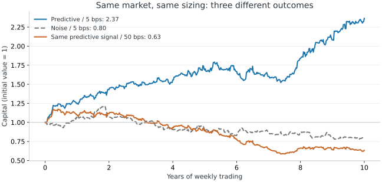
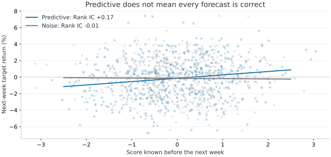
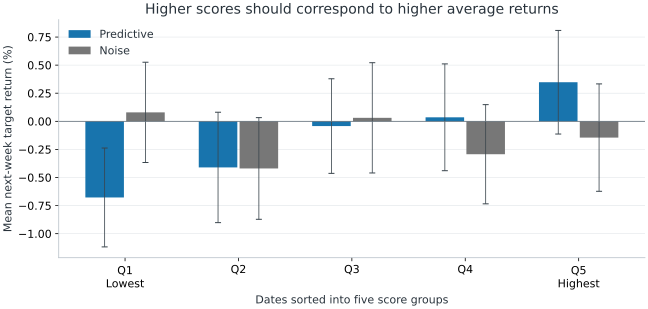
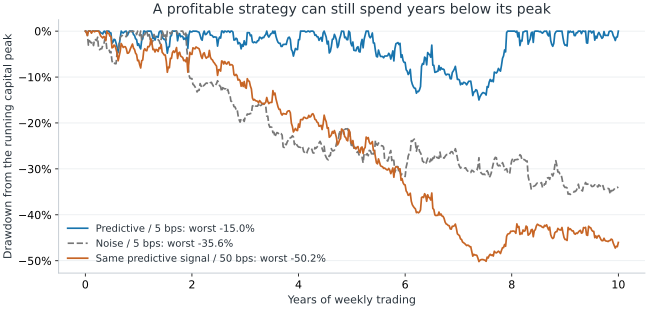
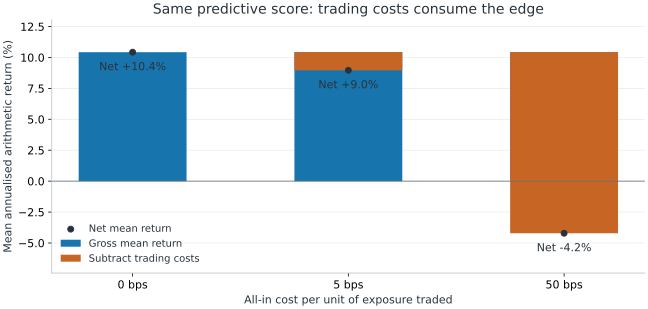

# Signal Evaluation

Signal evaluation asks three separate questions:

1. **Prediction:** does the score predict future returns out-of-sample?
2. **Tradability:** does a fixed sizing rule survive costs and drawdowns?
3. **Portfolio fit:** does it add Sharpe to the existing portfolio?

This chapter covers:

- the pre-registered protocol;
- the eight-step diagnostic checklist;
- debugging backtest-to-live failures.

**Prerequisites:** [[information-coefficient]], [[ic-significance]], [[icir-stability]], [[hit-rate]], [[fundamental-law-active-management]], [[signal-position-construction]], [[timing-curve-metrics]], [[turnover-cost-drag]], [[cross-validation-leakage]], [[multiple-testing]].

**Leads to:** [[grinold-alpha]], [[signal-to-weight]], [[carry-stock-bond-timing]], [[marginal-sharpe-improvement]].

**Sections:** [[timing-signal-evaluation]] · [[eval-directional-prediction]] · [[eval-statistical-significance]] · [[eval-directional-hit-rate]] · [[eval-sizing-monotonicity]] · [[eval-tradable-profitability]] · [[eval-turnover-costs]] · [[eval-temporal-stability]] · [[eval-correlation-redundancy]] · [[research-workflow]] · [[backtest-pitfalls]]



**Read the curves:** Over 520 weekly decisions on the same simulated market, a predictive score ($IC^{\mathrm{rank}} = +0.17$) traded at 5 bps compounds \$1 into **\$2.37** (blue), while pure noise ($IC^{\mathrm{rank}} = -0.01$) decays to **\$0.80** (grey). Trading the **exact same predictive score** at 50 bps decays to **\$0.63** (orange). Predictive skill and tradable profitability must be verified separately.

<details>
<summary>Simulation setup, equations and reproducibility</summary>

**Illustrative simulation (自己推理):** $T = 520$ weekly rebalance intervals (10 years), fixed seed `20261014` (`python scripts/generate_signal_figures.py`):

$$R_{t\to t+1}=0.025\left(0.18\,s_t+\sqrt{1-0.18^2}\,\varepsilon_{t+1}\right),\qquad w_t=\mathrm{clip}(s_t/2,-1,1),\qquad \Pi_{t+1}^{\mathrm{net}}=w_t R_{t\to t+1}-c|w_t-w_{t-1}|$$

**Variables:**

- $t=1,\dots,520$ weekly decision index
- $R_{t\to t+1}$ realised next-week spread return (weekly volatility $\sigma = 2.5\%$, annualised $\approx 18\%$)
- $s_t\sim\mathcal{N}(0,1)$ predictive score known at decision time $t$ (population correlation $0.18$, sample Rank IC $+0.166$)
- $\varepsilon_{t+1}\sim\mathcal{N}(0,1)$ independent forward return shock realised after decision $t$
- $w_t\in[-1,1]$ spread weight held over $[t, t+1]$ ($w_0 = 0$; noise benchmark replaces $s_t$ with independent $u_t\sim\mathcal{N}(0,1)$, sample Rank IC $-0.007$)
- $\Pi_{t+1}^{\mathrm{net}}$ weekly net strategy return after deducting one-way cost $c\in\{0, 5\text{ bps}, 50\text{ bps}\}$

</details>

<a id="timing-signal-evaluation"></a>

## Pre-Registration & The 8-Step Evaluation Checklist
<!-- section: timing-signal-evaluation | prerequisites: [information-coefficient, cross-validation-leakage, signal-position-construction, timing-curve-metrics] | related: [eval-directional-prediction, research-workflow, stock-bond-carry-case-study] | sources: [src-carry-course-notes, src-squarepoint-dqa-workbook] | tags: [checklist, signal-testing, diagnostics, pre-registration] -->

Never judge a candidate signal by a single backtest Sharpe ratio. Before viewing any return correlation, freeze the economic hypothesis, point-in-time data mapping, normalisation rule, forecast horizon $h$, and pass/kill thresholds, then evaluate the candidate across eight orthogonal diagnostics.

### The 8-part diagnostic checklist

| # | Diagnostic | Metric & Section | Institutional Benchmark | Why This Check Matters |
|---|---|---|---|---|
| **1** | **Directional skill** | Rank IC ([[eval-directional-prediction]]) | $0.03\text{–}0.08$ (Good)<br>$\le 0$ (Fail) · $> 0.10$ (Audit leakage) | Confirms raw monotonic forecast power before position sizing; $>0.10$ in liquid markets usually signals look-ahead leakage. |
| **2** | **Statistical significance** | Overlap-adjusted $t_{IC}$ ([[eval-statistical-significance]]) | $t \ge 1.5$ (macro timing)<br>$t \ge 2.0$ (single equity) / $\ge 3.0$ (multi-trial) | Deflates overlapping windows ($n_{\mathrm{eff}} = n/m$) so serial correlation does not manufacture fake significance. |
| **3** | **Directional accuracy** | Hit rate $HR$ ([[eval-directional-hit-rate]]) | $52\%\text{–}58\%$ (Realistic)<br>$\le 50\%$ (Coin flip) | Checks sign consistency; must be paired with payoff magnitude because high $HR$ with negative skew still loses money. |
| **4** | **Sizing monotonicity** | Quantile sort Q1–Q5 ([[eval-sizing-monotonicity]]) | Monotonic staircase $\bar R_1 < \dots < \bar R_5$<br>Humped / inverted Q5 (Fail) | Linear sizing ($w_t \propto s_t$) puts maximum capital on Q1/Q5; if Q5 loses money, conviction sizing blows up. |
| **5** | **Tradable profitability** | Timing curve & $\text{Max }DD$ ([[eval-tradable-profitability]]) | Positive $AR$, shallow/short $DD$<br>Multi-year underwater (Fail) | Simulates non-overlapping holding returns and checks whether drawdown depth and recovery duration fit the mandate. |
| **6** | **Execution survival** | Turnover $TO$ & Net $AR_{\mathrm{net}}$ ([[eval-turnover-costs]]) | $AR_{\mathrm{net}} > 0$ at realistic bps<br>Costs wipe out gross $AR$ (Fail) | Fast signals ($\rho_1 \approx 0.30$) churn portfolio weights and bleed alpha to bid-ask spread and market impact. |
| **7** | **Temporal stability** | Rolling 52w IC & Yearly IC ([[eval-temporal-stability]]) | $\text{ICIR} \ge 0.5$; $>70\%$ positive years<br>Single-year crisis windfall (Fail) | Verifies that performance is steady across regimes rather than a single lucky bet in 2008 or 2020. |
| **8** | **Portfolio increment** | Cross-signal $\rho$ & $\Delta SR$ ([[eval-correlation-redundancy]]) | $|\rho(s_{\mathrm{new}}, s_{\mathrm{book}})| \le 0.60$, $\Delta SR > 0$<br>$|\rho| > 0.60$ (Redundant) | Ensures the candidate adds independent breadth rather than doubling leverage on an existing factor. |

### Pre-registration discipline in code
Write the pass/kill gate into the evaluation script before running the backtest so the verdict is mechanical:
```python
verdict = "PASS to validate" if (rank_ic > 0 and t_stat_overlap >= 1.5) else "FAIL stop"
```
Modifying the data feed, lookback window, or forecast horizon after seeing `FAIL stop` is a **new trial** that must face the multiple-testing hurdle ($t \ge 3.0$, [[multiple-testing]]).

### Connections
- **Builds on:** [[information-coefficient]], [[cross-validation-leakage]], [[signal-position-construction]], [[timing-curve-metrics]].
- **Used by:** [[research-workflow]], [[carry-measurement-protocol]].

<a id="eval-directional-prediction"></a>

## Check 1: Directional Prediction (Rank IC)
<!-- section: eval-directional-prediction | prerequisites: [information-coefficient, timing-signal-evaluation] | related: [eval-statistical-significance, eval-directional-hit-rate, eval-sizing-monotonicity] | sources: [src-carry-course-notes, src-quant-finance-study-notes] | tags: [rank-ic, prediction, evaluation] -->

Check 1 evaluates whether higher signal scores $s_t$ predict higher forward returns $R_{t\to t+h}$ over the intended holding horizon using Spearman Rank IC (formula and properties in [[information-coefficient]]).

### Threshold rationale & failure modes
- **Target range ($IC \in [0.03, 0.08]$):** Financial returns are dominated by unforecastable shocks ($\varepsilon_{t+1}$). Even an IC of $0.04\text{–}0.06$ explains enough cross-sectional or temporal variation to generate a strong Sharpe ratio when combined with breadth or low turnover.
- **Zero or inverted ($IC \le 0$):** Gives an immediate stop under the registered orientation. Never flip the sign in-sample and claim a pass on the same dataset.
- **Too good to be true ($IC > 0.10$):** In liquid equities or macro futures, persistent IC above $0.10$ is a red flag for look-ahead bias (e.g. `shift(-h)` target misalignment, restatement leakage, or survivorship bias, [[backtest-pitfalls]]).

### Visual diagnostic: score vs forward-return scatter



**Read the plot:** Even for a genuinely predictive signal with $IC^{\mathrm{rank}} = +0.17$ (blue), individual weekly outcomes scatter widely above and below zero because $\sigma_\varepsilon \gg \text{signal slope}$. The upward regression slope emerges only across ratusan observations—which is why single-week outcomes cannot judge a quantitative model.

### Connections
- **Builds on:** [[information-coefficient]], [[timing-signal-evaluation]].
- **Used by:** [[eval-statistical-significance]], [[eval-directional-hit-rate]], [[eval-sizing-monotonicity]].

<a id="eval-statistical-significance"></a>

## Check 2: Statistical Significance & Overlap Adjustment
<!-- section: eval-statistical-significance | prerequisites: [ic-significance, effective-sample-size, multiple-testing, eval-directional-prediction] | related: [eval-temporal-stability] | sources: [src-carry-course-notes] | tags: [t-stat, overlap, sample-size] -->

Check 2 tests whether the sample IC is distinguishable from noise after deflating the sample size for overlapping forward return windows ($n_{\mathrm{eff}} = n / (h/\Delta)$, formula in [[ic-significance]]).

### Why the $t$-hurdle depends on the domain
| Strategy Domain | Effective Sample Size $n_{\mathrm{eff}}$ | Required $t$-Hurdle | Statistical Rationale |
|---|---|---|---|
| **Macro / Asset-Class Timing** (single spread, weekly 21d horizon) | $\sim 120\text{–}150$ over 10–15 years (only 2–3 business cycles) | $t_{IC} \ge 1.5$ (initial screen, one-sided $p \approx 0.067$) | Low statistical power: requiring $t \ge 2.0$ requires $IC \ge 0.17$, which would reject almost every genuine macro risk premium. |
| **Cross-Sectional Equity Selection** (single theoretical signal) | $500\text{ stocks} \times 52\text{ wks}$ ($T$ periodic ICs via $\text{ICIR}\sqrt{T}$) | $t \ge 2.0$ (two-sided $p \le 0.05$) | High cross-sectional breadth provides ample statistical power; failure to clear $2.0$ indicates noise. |
| **Multi-Trial Factor Mining / ML** ($M \ge 50$ variants or Round 2 redesign) | Any | $t \ge 3.0$ (Harvey–Liu–Zhu 2016, [[multiple-testing]]) | Corrects for family-wise false discoveries when searching across features, lookbacks, or universes. |

**Interview takeaway:** Always check whether a reported $t$-statistic was computed on raw $n$ or overlap-adjusted $n_{\mathrm{eff}}$ (or Newey–West lags $L \approx h$). Dividing out the $m = 4.2$ overlap cuts an apparent $t = 2.1$ down to an insignificant $t = 1.02$.

### Connections
- **Builds on:** [[ic-significance]], [[effective-sample-size]], [[multiple-testing]], [[eval-directional-prediction]].
- **Used by:** [[eval-temporal-stability]], [[research-workflow]].
- **Related:** [[robust-standard-errors]].

<a id="eval-directional-hit-rate"></a>

## Check 3: Directional Hit Rate & Payoff Asymmetry
<!-- section: eval-directional-hit-rate | prerequisites: [hit-rate, eval-directional-prediction] | related: [eval-tradable-profitability, win-rate-expectancy] | sources: [src-carry-course-notes] | tags: [hit-rate, win-rate] -->

Check 3 measures how often $\mathrm{sign}(s_t) = \mathrm{sign}(R_{t\to t+h})$ (formula in [[hit-rate]]) and cross-checks directional accuracy against win/loss payoff skew ([[win-rate-expectancy]]).

### Diagnostic interpretation
- **Realistic institutional range ($52\%\text{–}56\%$):** In liquid markets, a persistent $53\%$ hit rate with symmetric win/loss sizes compounds into a high Sharpe ratio.
- **Why $HR > 55\%$ can still fail (the Carry example):** In [[stock-bond-carry-case-study]], stock–bond carry achieved a $56\%$ ($60\%$ unadjusted) hit rate during the Select period—yet its timing curve suffered a $-27.7\%$ drawdown and failed statistical significance because its winning weeks were small steady carry ticks while its losing weeks were sharp risk-off equity selloffs.
- **Benchmark drift check:** Always compare $HR$ against the unconditional positive-return frequency $\Pr(R_{t\to t+h} > 0)$. During a bull market where equities rise $58\%$ of weeks, a constant positive score gets $HR = 58\%$ with $IC = 0$.

### Connections
- **Builds on:** [[hit-rate]], [[eval-directional-prediction]].
- **Used by:** [[eval-tradable-profitability]].
- **Related:** [[win-rate-expectancy]].

<a id="eval-sizing-monotonicity"></a>

## Check 4: Sizing Monotonicity & Quantile Sorts
<!-- section: eval-sizing-monotonicity | prerequisites: [eval-directional-prediction] | related: [eval-tradable-profitability, stock-bond-carry-case-study] | sources: [src-carry-course-notes] | tags: [quantile-sort, monotonicity, bucket-returns] -->

Check 4 sorts evaluation observations into $Q = 5$ quintiles by signal score $s_t$ and computes the mean forward return $\bar R_q$ in each bucket to verify that expected returns increase monotonically with signal conviction.

### Formula

$$\bar R_q=\frac{1}{|B_q|}\sum_{t\in B_q}R_{t\to t+h},\qquad q=1,\ldots,Q$$

**Variables:**

- $\bar R_q$ average forward simple return in score bucket $q$
- $q=1,\dots,Q$ bucket index ordered from lowest score ($q=1$) to highest score ($q=Q$, typically $Q=5$)
- $B_q$ set of observations (dates $t$ in timing, or asset-date pairs in selection) falling in bucket $q$
- $|B_q|$ number of observations in bucket $q$
- $t$ evaluation date index
- $h$ forecast horizon in trading days
- $R_{t\to t+h}$ realised forward return over horizon $h$

### Visual diagnostic: Monotonic staircase vs Hump trap



**Read the bars:**
- **Monotonic staircase (blue predictive signal):** $\bar R_1 < \bar R_2 < \bar R_3 < \bar R_4 < \bar R_5$, with Q1 strongly negative and Q5 strongly positive. Linear position sizing ($w_t = \mathrm{clip}(s_t/2, -1, 1)$) is well-specified because maximum capital is deployed where expected returns are highest.
- **Flat / noisy (grey):** Bucket means bounce randomly around zero with overlapping 95% confidence bars ($\pm 1.96\,\hat\sigma_q/\sqrt{|B_q|}$).
- **The Hump Trap:** In the Carry Select sample ([[stock-bond-carry-case-study]]), quintile returns were $-0.26\%, +0.73\%, +1.32\%, +0.63\%, \mathbf{-0.09\%}$. Even though Rank IC was slightly positive, **Q5 lost money**—meaning linear sizing puts maximum $100\%$ long exposure on the worst-performing bucket.

**Implementation note (breaking ties at caps):** When scores are clipped at $\pm 2$, many observations share the exact value $+2$ or $-2$. Rank with `df["z"].rank(method="first")` before calling `pd.qcut(..., 5)` so buckets maintain equal sample sizes $|B_q|$.

### Connections
- **Builds on:** [[eval-directional-prediction]].
- **Used by:** [[eval-tradable-profitability]], [[stock-bond-carry-case-study]].

<a id="eval-tradable-profitability"></a>

## Check 5: Tradable Profitability & Underwater Drawdown
<!-- section: eval-tradable-profitability | prerequisites: [timing-curve-metrics, signal-position-construction, eval-sizing-monotonicity] | related: [eval-turnover-costs, eval-temporal-stability, sharpe-ratio] | sources: [src-carry-course-notes] | tags: [timing-curve, drawdown, equity-curve] -->

Check 5 converts scores into executable weights $w_t$ and compounds non-overlapping holding-period returns to inspect the equity curve and the underwater drawdown profile ($V_t$, $AR$, and $DD_t$ formulas in [[timing-curve-metrics]]).

### Visual diagnostic: The underwater drawdown chart



**Read the drawdown:**
- Even the profitable predictive strategy at 5 bps (blue, compounding \$1 to \$2.37) suffers a **$-15\%$ maximum drawdown** and spends over a year below its prior peak.
- The noise strategy (grey) reaches **$-36\%$**, and the high-cost implementation of the predictive signal (orange, 50 bps) plunges to **$-50\%$**.
- **Allocator rule:** Institutional PMs read the underwater chart before the cumulative return chart. A strategy with a 10% annual return but a 4-year drawdown duration will be shut down or redeemed long before recovery.

### Horizon vs rebalance clock discipline
When a signal forecasts $h = 21$-day returns but the portfolio rebalances weekly ($\Delta = 5$ days), the timing curve must compound the **realised 1-week return** $w_t R_{t\to t+1}$ on each weekly rebalance step—never the overlapping 21-day return $R_{t\to t+21}$.

### Connections
- **Builds on:** [[timing-curve-metrics]], [[signal-position-construction]], [[eval-sizing-monotonicity]].
- **Used by:** [[eval-turnover-costs]], [[eval-temporal-stability]].
- **Related:** [[sharpe-ratio]], [[signal-to-weight]].

<a id="eval-turnover-costs"></a>

## Check 6: Turnover & Transaction Cost Feasibility
<!-- section: eval-turnover-costs | prerequisites: [turnover-cost-drag, eval-tradable-profitability] | related: [eval-correlation-redundancy, portfolio-construction-process] | sources: [src-carry-course-notes] | tags: [turnover, transaction-costs, net-return] -->

Check 6 deducts realistic transaction costs from every rebalance trade ($TO$, $\text{Cost} = c \cdot TO \cdot 52$, and $AR_{\mathrm{net}}$ formulas in [[turnover-cost-drag]]) to verify that gross alpha is not consumed by execution friction.

### Visual diagnostic: Gross alpha vs cost drag



**Read the cost bars:**
- The underlying predictive signal and target weights $w_t$ are identical across all three bars, earning an annualised arithmetic gross return of **+10.4%**.
- At **5 bps** (liquid index futures / ETFs), annual cost drag is **1.5%**, leaving **+8.9%** net.
- At **50 bps** (illiquid credit, small-cap equities, or wide bid-ask spreads), annual cost drag jumps to **14.6%**, flipping net return to **−4.2%**.

**Interview takeaway:** Before celebrating a high-IC short-horizon signal, compute its **breakeven transaction cost** $c^* = \frac{AR_{\text{gross}}}{52 \cdot TO}$. If $c^*$ is below the instrument's effective half-spread + market impact, the signal cannot be traded standalone and must either be smoothed (EWMA / trade buffer) or used only as a slow tilt on trades already triggered by other signals.

### Connections
- **Builds on:** [[turnover-cost-drag]], [[eval-tradable-profitability]].
- **Used by:** [[eval-correlation-redundancy]].
- **Related:** [[portfolio-construction-process]].

<a id="eval-temporal-stability"></a>

## Check 7: Temporal & Regime Stability
<!-- section: eval-temporal-stability | prerequisites: [icir-stability, eval-statistical-significance, eval-tradable-profitability] | related: [eval-correlation-redundancy] | sources: [src-carry-course-notes] | tags: [rolling-ic, yearly-ic, regime-stability] -->

Check 7 inspects whether predictive skill and net returns persist across subperiods and macro regimes rather than coming from a single crisis windfall ($\text{ICIR}$ formula in [[icir-stability]]).

### Three standard stability views
1. **Rolling 52-week Rank IC:** Plots trailing 1-year Rank IC over time.
   - *Healthy:* Hovers predominantly above zero, with brief dips during regime transitions.
   - *Red flag:* Oscillates symmetrically around zero (pure noise, as seen in `equity_bond_carry`) or decays secularly toward zero (alpha crowding / structural change).
   - *Caveat:* Consecutive 52-week windows share 51 weeks of data; visual smoothness is a product of window overlap, not 52 independent tests per year.
2. **Calendar-year IC & hit rate (minimum 10 weeks per year):** Checks that at least $\sim 70\%$ of full calendar years show positive IC, ruling out "one-hit wonder" signals that made 100% of their cumulative P&L during 2008 or March 2020.
3. **Ex-ante macro regime splits:** Evaluates performance across pre-defined rate/volatility environments (e.g. ZIRP 2009–2021 vs post-2022 rate-hiking regime, where zero rates pinned both legs of stock–bond carry and caused a variance drought, [[carry-case-diagnosis]]).

### Connections
- **Builds on:** [[icir-stability]], [[eval-statistical-significance]], [[eval-tradable-profitability]].
- **Used by:** [[eval-correlation-redundancy]], [[research-workflow]].
- **Related:** [[cross-validation-leakage]].

<a id="eval-correlation-redundancy"></a>

## Check 8: Signal Redundancy & Incremental Portfolio Value
<!-- section: eval-correlation-redundancy | prerequisites: [information-coefficient, eval-turnover-costs, eval-temporal-stability] | related: [marginal-sharpe-improvement, fundamental-law-active-management, research-workflow] | sources: [src-carry-course-notes, src-quant-finance-study-notes] | tags: [correlation, redundancy, diversification] -->

A signal that passes Checks 1–7 standalone must still clear Check 8: it must add **independent information** relative to the signals already in the portfolio rather than duplicating an existing factor bet.

### Two-step redundancy & increment test
1. **Cross-signal correlation screen ($|\rho(s_{\mathrm{new}}, s_{\mathrm{existing}})| \le 0.60$):**
   - Compute pairwise correlation between the candidate score (and its strategy return series) and every signal already in production.
   - If $|\rho| > 0.60$, the candidate is largely redundant with an existing signal ([[ic-contribution]]). Either discard the weaker signal or orthogonalise the candidate against the existing book and re-test the residual.
2. **Marginal Sharpe improvement condition ([[marginal-sharpe-improvement]]):**
   - Adding a new strategy with standalone Sharpe $SR_{\mathrm{new}}$ and return correlation $\rho$ with the existing portfolio ($SR_{\mathrm{base}}$) improves the combined frictionless Sharpe ratio if and only if $SR_{\mathrm{new}} > \rho\,SR_{\mathrm{base}}$.
   - When orthogonalised ($\rho = 0$), the optimal combined Sharpe ratio is $SR_{\mathrm{comb}} = \sqrt{SR_{\mathrm{base}}^2 + IR_{\mathrm{new}}^2}$. In production, verify that net portfolio Sharpe improves **after** accounting for combined turnover netting and risk constraints.

### Connections
- **Builds on:** [[information-coefficient]], [[eval-turnover-costs]], [[eval-temporal-stability]].
- **Used by:** [[research-workflow]], [[signal-to-weight]].
- **Related:** [[marginal-sharpe-improvement]], [[fundamental-law-active-management]], [[ic-contribution]].

<a id="research-workflow"></a>

## Research Workflow & Interview Project Storytelling
<!-- section: research-workflow | prerequisites: [cross-validation-leakage, eval-statistical-significance, eval-correlation-redundancy] | related: [backtest-pitfalls, multiple-testing] | sources: [src-squarepoint-dqa-workbook] | tags: [research, communication, workflow] -->

Every research project should follow a reproducible seven-step lifecycle from economic hypothesis to post-deployment monitoring, and a candidate should be ready to present any project at three time budgets in an interview.

### The 7-step research lifecycle
1. **Economic Hypothesis:** State *why* the return premium or inefficiency exists (behavioral bias, institutional constraint, or risk transfer) and who takes the other side.
2. **Point-in-Time Data Audit:** Map every input to its publication timestamp, corporate-action adjustment, and universe roster ([[backtest-pitfalls]]).
3. **Unparameterised Baseline:** Build the simplest zero-free-parameter benchmark first (e.g. equal-weight or 12M expanding z-score).
4. **Three-Stage Isolation:** Freeze Select / Validate / Test splits and purge boundary-straddling forward windows ([[cross-validation-leakage]]).
5. **8-Check Diagnostic & Cost Stress:** Run the frozen candidate through Checks 1–8 under realistic transaction costs.
6. **Recorded Verdict:** Either **Proceed** (all gates cleared), **Stop** (record negative finding and keep later samples sealed, as in [[stock-bond-carry-case-study]]), or **Register Round 2** (document the change and raise the $t$-hurdle to $\ge 3.0$).
7. **Live Telemetry & Kill Criteria:** Monitor live vs paper fills, rolling IC, and factor exposures against pre-set stop-loss triggers.

### Presenting a research project at three interview depths
- **30-second pitch:** Economic hypothesis → your specific modeling/data design → headline out-of-sample net result (or disciplined kill decision).
- **2-minute overview:** Universe & point-in-time data → baseline vs proposed signal → validation protocol & $n_{\mathrm{eff}}$ → gross vs net Sharpe/turnover → main limitation.
- **10-minute deep dive:** Exact equations, edge cases & data bugs fixed (e.g. `auto_adjust` dividend denominator, straddle purging), failed variants & why they failed, transaction-cost breakeven, and how the signal interacts with the rest of the book.

### 6-step quantitative problem-solving protocol
1. **Clarify the setup:** Confirm asset class, horizon, constraints, and edge assumptions.
2. **Define variables:** State every symbol, dimension, and time subscript ($t$ vs $t+h$).
3. **State the governing principle:** Name the theorem first (no-arbitrage, Itô, Gauss–Markov, Bayes, KKT).
4. **Write the anchor equation:** Lay down the cleanest starting formula before algebra.
5. **Solve & check boundary limits:** Verify $\sigma \to 0$, $\rho \to \pm 1$, $T \to 0$, or equal-volatility special cases.
6. **State where the model breaks:** Give the desk reality (illiquidity, fat tails, discrete hedging, estimation error).

### Connections
- **Builds on:** [[cross-validation-leakage]], [[eval-statistical-significance]], [[eval-correlation-redundancy]].
- **Used by:** [[backtest-pitfalls]].
- **Related:** [[multiple-testing]], [[carry-case-diagnosis]].

<a id="backtest-pitfalls"></a>

## Backtest Pitfalls & Debugging Live Underperformance
<!-- section: backtest-pitfalls | alias: [broker-research-replication] | prerequisites: [research-workflow, multiple-testing] | related: [cross-validation-leakage, price-reconciliation, sharpe-ratio, conditional-probability-bayes] | sources: [src-squarepoint-dqa-workbook] | tags: [backtest, overfitting, survivorship, debugging] -->

<a id="broker-research-replication"></a>

When a strategy with a strong backtest Sharpe ratio immediately loses money in live trading, investigate strictly from **mechanical plumbing bugs** to **statistical/regime explanations**—never blame a "regime shift" before ruling out a code or execution discrepancy.

### "Sharpe 4 in backtest, loses money live" — 4-level root-cause hierarchy

| Priority Level | Category | Concrete Checks to Run First |
|---|---|---|
| **Level 1: Plumbing & Data Leakage** | Code / Timestamp mismatch | Re-run backtest on the exact live window and diff signals, target weights, and fills timestamp-by-timestamp ([[price-reconciliation]]). Check for `shift(-1)` look-ahead, unlagged macro releases, dividend/split adjustment bugs, duplicate rows, stale close prices, and survivorship-biased universes. |
| **Level 2: Execution & Accounting** | Unmodeled frictions | Compare assumed mid-price fills against actual execution: bid-ask spread, market impact (>5% ADV participation), short-borrow fees, financing rates, and pre-trade risk-limit clipping. |
| **Level 3: Selection Bias & Overfitting** | Research process | Count total signal variants, parameters, and post-hoc tweaks tried ($M$). Apply the multiple-testing haircut ([[multiple-testing]]) and Bayes' rule on low base-rate true signals ([[conditional-probability-bayes]]). |
| **Level 4: Regime Shift & Crowding** | Market structure | Only after Levels 1–3 reconcile cleanly: check whether realized return volatility, cross-asset correlation, or peer factor crowding shifted outside the historical training distribution. |

**Interview takeaway:** A bad first week or month is also checked against the expected distribution of drawdowns under the true ex-ante Sharpe ratio ($SR = 1.5$ still has a $\sim 16\%$ probability of losing money over a full year, and near $50\%$ over a single week). First verify that live code matches backtest code on identical timestamps; then quantify whether the realized loss exceeds normal sampling variance.

### Connections
- **Builds on:** [[research-workflow]], [[multiple-testing]].
- **Related:** [[cross-validation-leakage]], [[price-reconciliation]], [[sharpe-ratio]], [[conditional-probability-bayes]].
