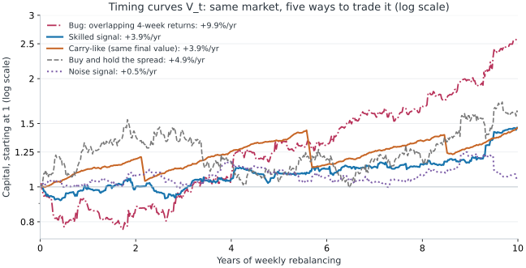
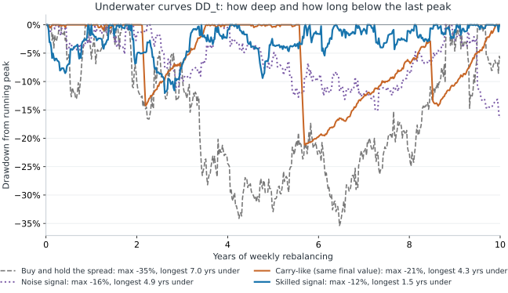

# Signal Metrics

This chapter defines the core mathematical metrics used to measure a signal's standalone predictive skill, statistical reliability, and implementation friction before full portfolio optimisation: the Information Coefficient (Pearson vs Rank IC, cross-sectional vs time-series, and composite IC attribution), overlap-adjusted $t$-statistics, temporal stability via ICIR, directional hit rate, the Fundamental Law of Active Management, and diagnostic score-to-weight mapping for timing curves, drawdowns, and turnover drag.

**Prerequisites:** [[returns-simple-log]], [[variance-covariance-correlation]], [[effective-sample-size]], [[time-series-validation]].

**Leads to:** [[timing-signal-evaluation]], [[grinold-alpha]], [[signal-to-weight]], [[black-litterman]], [[multi-asset-signals]].

**Sections:** [[information-coefficient]] · [[ic-contribution]] · [[ic-significance]] · [[icir-stability]] · [[hit-rate]] · [[fundamental-law-active-management]] · [[signal-position-construction]] · [[timing-curve-metrics]] · [[turnover-cost-drag]]

## Information Coefficient
<!-- section: information-coefficient | prerequisites: [variance-covariance-correlation, effective-sample-size] | related: [ic-contribution, ic-significance, icir-stability, hit-rate, timing-signal-evaluation] | sources: [src-quant-finance-study-notes, src-carry-course-notes] | tags: [ic, rank-ic, pearson, spearman] -->

The Information Coefficient (IC) measures the correlation between a signal known at decision time $t$ and the subsequent forward return over horizon $h$. Cross-sectional asset selection correlates across assets $i$ on a fixed date $t$; time-series timing correlates across dates $t$ for a single asset or spread.

### Formula

$$IC_t^{\mathrm{CS}}=\operatorname{corr}_{i}(s_{i,t},R_{i,t\to t+h}),\qquad IC^{\mathrm{TS}}=\operatorname{corr}_{t}(s_t,R_{t\to t+h})$$

**Variables:**

- $IC_t^{\mathrm{CS}}\in[-1,1]$ cross-sectional IC on date $t$ across assets $i$
- $IC^{\mathrm{TS}}\in[-1,1]$ time-series (timing) IC across evaluation dates $t$
- $i=1,\dots,N$ asset index in the tradable cross-section at date $t$
- $t$ decision date (after signal inputs are published, before trade execution)
- $s_{i,t}$ signal score of asset $i$ known at date $t$
- $s_t$ signal score of the single asset or spread being timed at date $t$
- $h$ forward holding horizon in trading days
- $R_{i,t\to t+h}$ realised forward simple return of asset $i$ from $t$ to $t+h$
- $R_{t\to t+h}$ realised forward simple return of the timed asset or spread from $t$ to $t+h$
- $\operatorname{corr}_{i}$ correlation across assets on date $t$
- $\operatorname{corr}_{t}$ correlation across dates in the evaluation sample

### Rank IC (Spearman correlation)

$$IC^{\mathrm{rank}}=\operatorname{corr}(\operatorname{rk}(s),\operatorname{rk}(R))=1-\frac{6\sum_{j=1}^{n}d_j^2}{n(n^2-1)}$$

**Variables:**

- $IC^{\mathrm{rank}}\in[-1,1]$ Spearman rank correlation between scores and forward returns
- $s$ vector of signal scores (cross-sectional or time-series)
- $R$ matching vector of realised forward returns
- $\operatorname{rk}$ ascending rank operator ($1,\dots,n$, assigning average ranks to ties)
- $n$ number of matched observations (the closed-form $d_j^2$ shortcut holds when there are no ties)
- $j=1,\dots,n$ observation index
- $d_j=\operatorname{rk}(s_j)-\operatorname{rk}(R_j)$ rank difference for observation $j$

### Key points

- **Pearson IC vs Rank IC:** Pearson IC measures linear association in raw levels, which aligns directly with linear position sizing ($w_i \propto s_i$) and Grinold's alpha formula ([[grinold-alpha]]), but a single fat-tailed crash or earnings jump can dominate the estimate. **Rank IC** measures monotonic ordering and is invariant to strictly increasing transformations; it is the default screening metric for heavy-tailed financial returns.
- **Practical magnitude benchmarks:**
  - $|IC| \in [0.01, 0.03]$: noisy / weak standalone edge; requires high breadth ($BR$) and low turnover to trade profitably.
  - $|IC| \in [0.03, 0.06]$: solid institutional signal in liquid daily/weekly equities or macro spreads.
  - $|IC| > 0.10$: rare in liquid markets; **audit for look-ahead leakage first** (e.g. `shift(-h)` alignment bugs, full-sample standardisation, or restated macro data) before celebrating.
- **Sign orientation:** Fixing the expected sign ($+1$ or $-1$) is part of signal specification. Flipping a negative in-sample IC into a "contrarian signal" after inspecting results is an extra degree of freedom and requires fresh out-of-sample validation.

### Worked example

| Asset | Score | Score rank | Weekly return | Return rank | Rank difference $d_j$ | $d_j^2$ |
|---|---|---|---|---|---|---|
| A | +1.2 | 4 | +0.8% | 4 | 0 | 0 |
| B | −0.5 | 2 | −0.2% | 2 | 0 | 0 |
| C | +0.3 | 3 | +1.5% | 5 | −2 | 4 |
| D | +2.0 | 5 | +0.4% | 3 | +2 | 4 |
| E | −1.1 | 1 | −0.6% | 1 | 0 | 0 |

Here $\sum d_j^2 = 8$ and $n = 5$, so $IC^{\mathrm{rank}} = 1 - \frac{6\times 8}{5\times 24} = 0.60$, while Pearson IC is $0.5436$. If asset E suffers a $-10.0\%$ crash instead of $-0.6\%$, all ranks remain unchanged so $IC^{\mathrm{rank}}$ stays **0.60**, whereas Pearson IC jumps to **0.6735** on a single tail observation.

### Connections

- **Builds on:** [[variance-covariance-correlation]], [[effective-sample-size]].
- **Used by:** [[ic-contribution]], [[ic-significance]], [[icir-stability]], [[fundamental-law-active-management]], [[eval-directional-prediction]].

## IC Contribution of a Composite Score
<!-- section: ic-contribution | prerequisites: [information-coefficient] | related: [grinold-alpha, eval-correlation-redundancy] | sources: [src-quant-finance-study-notes] | tags: [ic-contribution, composite, correlation] -->

When $K$ component signals are combined linearly into a composite score $S$, covariance linearity decomposes the composite Pearson IC into an exact sum of component contributions scaled by composite volatility.

### Formula

$$S=\sum_{k=1}^{K}a_k s_k,\qquad IC_S=\sum_{k=1}^{K}\phi_k IC_k,\qquad \phi_k=\frac{a_k\sigma_k}{\sigma_S}$$

**Variables:**

- $S$ composite score vector
- $K$ number of component signals
- $k=1,\dots,K$ component index
- $a_k$ weight assigned to component $k$ in the composite
- $s_k$ score vector of component $k$
- $IC_S$ Pearson IC of the composite score $S$ against forward returns
- $IC_k$ standalone Pearson IC of component $k$ against the same forward returns
- $\phi_k$ correlation scaling weight of component $k$
- $\sigma_k$ sample standard deviation of component $k$
- $\sigma_S=\sqrt{\sum_{j,l} a_j a_l \operatorname{Cov}(s_j, s_l)}$ sample standard deviation of the composite score ($\sigma_S > 0$)

### Key points

- **Diversification boost ($\sum_k \phi_k > 1$):** Whenever components are imperfectly correlated ($\rho_{jl} < 1$), $\sigma_S < \sum_k |a_k|\sigma_k$, so the scaling coefficients $\phi_k$ sum to more than 1. Combining low-correlation signals yields a composite $IC_S$ strictly greater than the weighted average of standalone ICs.
- **Pearson vs Rank IC:** This additive decomposition is exact for **Pearson IC** because covariance is bilinear. It holds only approximately for Rank IC because ranking the sum $\operatorname{rk}(\sum a_k s_k)$ is nonlinear.

### Worked example

Combine unit-variance Value, Momentum, and Quality with equal weights $a_k = 1/3$ and pairwise correlations $\rho_{VM}=0.10$, $\rho_{VQ}=0.30$, $\rho_{MQ}=0.00$. Then:
$$\sigma_S = \frac{1}{3}\sqrt{3 + 2(0.10 + 0.30 + 0.00)} = \frac{\sqrt{3.8}}{3} \approx 0.6498,\qquad \phi_k = \frac{1/3}{0.6498} \approx 0.5130$$

| Component | Standalone Pearson $IC_k$ | Contribution $\phi_k IC_k$ | Share of $IC_S$ |
|---|---|---|---|
| Value | 0.040 | 0.0205 | 33.3% |
| Momentum | 0.050 | 0.0256 | 41.7% |
| Quality | 0.030 | 0.0154 | 25.0% |
| **Composite $S$** | — | **0.0616** | **100.0%** |

Because of low cross-signal correlation, the composite Pearson IC (**0.0616**) beats the average standalone IC ($0.040$) by **54%** and exceeds even the strongest individual signal ($0.050$).

### Connections

- **Builds on:** [[information-coefficient]].
- **Used by:** [[grinold-alpha]].
- **Related:** [[eval-correlation-redundancy]].

## Statistical Uncertainty of IC
<!-- section: ic-significance | prerequisites: [information-coefficient, effective-sample-size] | related: [icir-stability, eval-statistical-significance, multiple-testing] | sources: [src-carry-course-notes, src-quant-finance-study-notes] | tags: [t-stat, significance, overlap-adjustment, newey-west] -->

An estimated IC is a noisy sample statistic. When the forecast horizon $h$ is longer than the sampling step $\Delta$, consecutive forward return windows overlap and share market shocks, so the raw sample count $n$ must be deflated to the effective sample size $n_{\mathrm{eff}}$ before computing a $t$-statistic.

### Formula

$$t_{IC}\approx\frac{\widehat{IC}\sqrt{n_{\mathrm{eff}}-2}}{\sqrt{1-\widehat{IC}^{\,2}}}\approx \widehat{IC}\sqrt{n_{\mathrm{eff}}-2},\qquad m=\frac{h}{\Delta},\qquad n_{\mathrm{eff}}\approx\frac{n}{m}$$

**Variables:**

- $t_{IC}$ overlap-adjusted $t$-statistic testing $H_0: IC = 0$
- $\widehat{IC}\in(-1,1)$ sample IC estimate ($\sqrt{1-\widehat{IC}^2}\approx 1$ for typical $|IC| < 0.15$)
- $n_{\mathrm{eff}}$ effective number of non-overlapping observations ($n_{\mathrm{eff}} > 2$)
- $n$ raw number of sampled score/return pairs
- $m$ overlap ratio when $h \ge \Delta$
- $h$ forward return horizon in trading days (e.g. $h = 21$ for 1-month returns)
- $\Delta$ sampling interval in trading days (e.g. $\Delta = 5$ for weekly sampling)

### Key points

- **Why naive $t$-stats fail on overlapping windows:** Sampling 21-day forward returns every 5 trading days means adjacent rows share 16 trading days of identical market moves ($m = 21/5 = 4.2$). Using raw $n$ instead of $n_{\mathrm{eff}} = n/4.2$ inflates $t_{IC}$ by $\sqrt{4.2} \approx 2.05\times$, turning pure noise ($t \approx 1.0$) into fake significance ($t \approx 2.05$).
- **Cross-sectional vs time-series $t$-stat:**
  - **Time-series timing:** one series of $n$ dates → use $t_{IC} \approx \widehat{IC}\sqrt{n_{\mathrm{eff}}-2}$ (or Newey–West HAC standard errors on the predictive regression, [[robust-standard-errors]]).
  - **Cross-sectional equity selection:** compute cross-sectional $IC_t$ on each non-overlapping date $t = 1,\dots,T$, then test whether the mean $\overline{IC}$ differs from zero via $t = \frac{\overline{IC}}{\sigma_{IC}/\sqrt{T}} = \text{ICIR}\sqrt{T}$ ([[icir-stability]]). Never pool all $N \times T$ stock-date pairs into a single correlation—cross-sectional stock returns share market and sector factors and are not independent.
- **Pass/fail hurdles:** what the hurdle $t^*$ means, its false-positive rate and power, and which value to use for timing, cross-sectional and multi-trial research are in [[eval-statistical-significance]].

### Worked example

In the stock–bond carry timing study ([[stock-bond-carry-case-study]]), $n = 574$ weekly observations of $h = 21$-day forward returns give:
$$m = \frac{21}{5} = 4.2,\qquad n_{\mathrm{eff}} = \frac{574}{4.2} \approx 136.7,\qquad \sqrt{n_{\mathrm{eff}}-2} = \sqrt{134.7} \approx 11.61$$
- **Baseline registered run (`auto_adjust=True`):** $\widehat{IC} = +0.0252 \implies t_{IC} \approx 0.0252 \times 11.61 = +0.29$ (naive unadjusted $t$ would be $0.0252\sqrt{572} = +0.60$).
- **Unadjusted-close denominator check (`auto_adjust=False`):** $\widehat{IC} = +0.0423 \implies t_{IC} \approx 0.0423 \times 11.61 = +0.49$.
- **Minimum IC required to pass $t \ge 1.5$:** $IC_{\min} = 1.5 / 11.61 \approx 0.129$. Both runs fall far below the hurdle.

### Connections

- **Builds on:** [[information-coefficient]], [[effective-sample-size]].
- **Used by:** [[eval-statistical-significance]], [[stock-bond-carry-case-study]].
- **Related:** [[multiple-testing]], [[robust-standard-errors]].

## ICIR: Stability of Signal Over Time
<!-- section: icir-stability | prerequisites: [information-coefficient] | related: [ic-significance, timing-signal-evaluation] | sources: [src-quant-finance-study-notes] | tags: [icir, stability, sharpe-of-ic] -->

The Information Coefficient Information Ratio (ICIR) is the mean periodic cross-sectional IC divided by its time-series standard deviation—effectively the **Sharpe ratio of the periodic IC series itself**. It measures how consistently a signal predicts cross-sectional ordering from period to period.

### Formula
$$\text{ICIR}=\frac{\overline{IC}}{\sigma_{IC}},\qquad \overline{IC}=\frac1T\sum_{t=1}^TIC_t,\qquad \sigma_{IC}=\sqrt{\frac{1}{T-1}\sum_{t=1}^T(IC_t-\overline{IC})^2}$$

**Variables:**

- $\text{ICIR}$ information coefficient information ratio (dimensionless, per period unless annualised)
- $\overline{IC}$ sample mean of periodic cross-sectional ICs across $T$ periods
- $\sigma_{IC}$ sample standard deviation of periodic ICs ($\sigma_{IC} > 0$)
- $IC_t$ cross-sectional IC realised at period $t$
- $T$ number of evaluation periods ($T > 1$)
- $t=1,\dots,T$ evaluation period index

### Why ICIR matters: consistency beats peak IC
Consider two signals evaluated over $T = 36$ monthly cross-sections:
- **Signal A (Volatile Gambler):** $\overline{IC} = +0.06$, $\sigma_{IC} = 0.20 \implies \text{ICIR} = 0.30$ ($t = 0.30\sqrt{36} = 1.80$). It occasionally posts $+0.30$ months but suffers $-0.25$ reversals during factor rotations, triggering risk-limit drawdowns.
- **Signal B (Steady Engine):** $\overline{IC} = +0.04$, $\sigma_{IC} = 0.05 \implies \text{ICIR} = 0.80$ ($t = 0.80\sqrt{36} = 4.80$). Despite a lower average IC, its low variance delivers a $2.7\times$ higher $t$-statistic and far more reliable capital compounding.

**Interview takeaway:**
- Link to $t$-statistic: for $T$ non-overlapping cross-sections, $t(\overline{IC}) = \text{ICIR} \times \sqrt{T}$.
- Always state the period frequency (daily, weekly, monthly) and whether $\text{ICIR}$ is reported per-period or annualised ($\text{ICIR}_{\text{ann}} = \sqrt{P}\,\text{ICIR}_{\text{period}}$). Per-month $\text{ICIR} \ge 0.5$ (annualised $\ge 1.7$) is a strong institutional benchmark.

### Connections
- **Builds on:** [[information-coefficient]].
- **Used by:** [[eval-temporal-stability]], [[timing-signal-evaluation]].

## Directional Hit Rate
<!-- section: hit-rate | prerequisites: [information-coefficient] | related: [ic-significance, timing-signal-evaluation, win-rate-expectancy] | sources: [src-carry-course-notes] | tags: [hit-rate, win-rate, direction] -->

The directional hit rate measures the fraction of evaluation periods in which the sign of the signal agrees with the sign of the subsequent return.

### Formula
$$HR=\frac1T\sum_{t=1}^T\mathbf{1}_{\{\mathrm{sign}(s_t)=\mathrm{sign}(R_{t\to t+h})\}}$$

**Variables:**

- $HR\in[0,1]$ directional hit rate (fraction of periods where signal and forward return share the same sign)
- $T$ number of active evaluation dates (excluding flat $s_t = 0$ abstentions)
- $s_t$ directional signal score at date $t$ ($s_t = 0$ is neutral)
- $t=1,\dots,T$ evaluation date index
- $h$ forecast horizon in trading days
- $R_{t\to t+h}$ realised forward simple return over horizon $h$
- $\mathrm{sign}(\cdot)$ sign operator ($+1$ if positive, $-1$ if negative, $0$ if zero)
- $\mathbf{1}_{\{\cdot\}}$ indicator function ($1$ if condition holds, $0$ otherwise)

### Why hit rate alone is deceptive (the magnitude asymmetry trap)
Hit rate discards return magnitudes completely ([[win-rate-expectancy]]):
- Suppose a carry or short-vol strategy wins **58%** of weeks earning $+0.2\%$ per win, and loses **42%** of weeks during risk-off selloffs losing $-3.0\%$ per loss.
- Expected weekly return is $0.58(+0.2\%) + 0.42(-3.0\%) = -1.144\%$ per week—catastrophic negative expectancy despite a "58% win rate".
- **Baseline drift caveat:** If an equity index goes up 56% of weeks structurally, a trivial "always long" signal achieves $HR = 56\%$ with zero timing skill. Always inspect $HR$ alongside Rank IC and the quantile return staircase ([[eval-sizing-monotonicity]]).

### Connections
- **Builds on:** [[information-coefficient]].
- **Used by:** [[eval-directional-hit-rate]], [[timing-signal-evaluation]].
- **Related:** [[win-rate-expectancy]].

## The Fundamental Law of Active Management
<!-- section: fundamental-law-active-management | prerequisites: [information-coefficient] | related: [grinold-alpha, eval-correlation-redundancy, measuring-performance] | sources: [src-quant-finance-study-notes] | tags: [fundamental-law, information-ratio, breadth, transfer-coefficient] -->

Grinold (1989) and Clarke, de Silva & Thorley (2002) decompose a portfolio's achievable ex-ante Information Ratio ($IR$) into three multiplicative pillars: **skill** ($IC$), **independent breadth** ($\sqrt{BR}$), and **implementation efficiency** ($TC$).

### Formula

$$IR=\frac{E[A]}{\sigma_A}\approx IC\cdot\sqrt{BR}\cdot TC$$

**Variables:**

- $IR$ ex-ante annualised Information Ratio (expected active return per unit of tracking error)
- $A=R_p-R_b$ portfolio active return relative to benchmark
- $E[A]$ expected annual active return
- $\sigma_A$ annualised tracking error (standard deviation of $A$, $\sigma_A > 0$)
- $IC$ average forecast skill per independent bet (correlation between risk-adjusted forecasts and realised residual returns)
- $BR$ breadth: number of **independent** active bets taken per year
- $TC\in[-1,1]$ Transfer Coefficient: cross-sectional correlation between risk-adjusted alphas $\Sigma^{-1/2}\alpha$ and risk-adjusted active weights $\Sigma^{1/2}w_{\text{active}}$ ($TC = 1$ for unconstrained MVO; typically $0.3\text{–}0.6$ under long-only, sector, and turnover constraints)

### Effective breadth under cross-sectional correlation

When $N$ bets have average pairwise correlation $\bar\rho > 0$, they do not provide $N$ independent opportunities:

$$N_{\mathrm{eff}}=\frac{N}{1+(N-1)\bar\rho}$$

**Variables:**

- $N_{\mathrm{eff}}$ effective number of independent cross-sectional bets per rebalance
- $N$ nominal number of assets in the universe
- $\bar\rho$ average pairwise correlation among the forecasted return residuals ($1+(N-1)\bar\rho > 0$)

### Key points

- **Why $BR \ll N \times \text{rebalances}$:** Two pitfalls inflate naive breadth:
  1. **Cross-sectional correlation:** If $N = 500$ stocks share an unhedged factor exposure with $\bar\rho = 0.20$, $N_{\mathrm{eff}} = \frac{500}{1 + 499(0.20)} \approx 4.96$ independent bets, not 500.
  2. **Temporal persistence:** Rebalancing a slow-moving value or carry signal ($\rho_1 \approx 0.95$) 52 times a year does not create 52 independent time-series bets—it repeats the same annual bet 52 times.
- **How constraints enter via $TC$:** In an unconstrained portfolio ($w_{\text{active}} \propto \Sigma^{-1}\alpha$), $TC = 1$. Long-only constraints ($w_i \ge 0$) prevent shorting small-benchmark-weight stocks with strongly negative alpha, cutting $TC$ to $\sim 0.4\text{–}0.6$ and directly scaling down achievable $IR$.

### Worked example

A market-neutral equity pod has $IC = 0.03$, $BR = 400$ independent bets/year, and $TC = 0.85$:
$$IR \approx 0.03 \times \sqrt{400} \times 0.85 = 0.03 \times 20 \times 0.85 = 0.51$$
A long-only mutual fund with the same $IC = 0.03$ and $BR = 400$ but constrained to $TC = 0.40$ achieves only $IR \approx 0.03 \times 20 \times 0.40 = 0.24$.

### Connections

- **Builds on:** [[information-coefficient]].
- **Used by:** [[grinold-alpha]], [[eval-correlation-redundancy]].
- **Related:** [[measuring-performance]].

## Signal Position Construction (Score to Weight)
<!-- section: signal-position-construction | prerequisites: [information-coefficient] | related: [time-series-momentum, timing-curve-metrics, turnover-cost-drag, signal-to-weight] | sources: [src-carry-course-notes, src-signal-to-weight] | tags: [momentum, z-score, clipping, position-sizing] -->

To evaluate a timing or single-spread signal without introducing portfolio-optimiser parameters, map the raw indicator $x_t$ into a bounded, unitless score $s_t \in [-2, +2]$ using only point-in-time history, then scale linearly into a diagnostic spread weight $w_t \in [-1, +1]$.

### Formula

$$z_t=\frac{x_t-\bar x_{\le t}}{\hat\sigma_{\le t}},\qquad s_t=\mathrm{clip}(z_t,-2,+2),\qquad w_t=\mathrm{clip}\left(\frac{s_t}{2},-1,+1\right)$$

**Variables:**

- $x_t$ raw signal value known at decision date $t$ (e.g. 12-month price momentum $P_t/P_{t-12}-1$ or relative carry $DY_t - y_t^{10}$)
- $\bar x_{\le t}$ expanding sample mean of $x_u$ over all available dates $u \le t$ (after a minimum warm-up, e.g. 20 observations)
- $\hat\sigma_{\le t}$ expanding sample standard deviation of $x_u$ over $u \le t$ ($\hat\sigma_{\le t} > 0$)
- $z_t$ point-in-time expanding z-score at date $t$
- $s_t\in[-2,+2]$ winsorised/clipped signal score
- $w_t\in[-1,+1]$ diagnostic spread weight ($+1$ = 100% long leg 1 / short leg 2; $0$ = flat; $-1$ = 100% reverse)
- $t$ decision date
- $\mathrm{clip}(v, a, b)=\min(\max(v,a),b)$ bounding operator

### Key points

1. **Expanding vs rolling window:** A rolling window (e.g. 12M or 36M) adds a free lookback parameter that researchers often tune to improve backtest Sharpe; an **expanding window** (`NORMALIZE_WINDOW = None`) is parameter-free and strictly point-in-time, though slower to adapt to permanent regime shifts in mean levels.
2. **Why clip at $\pm 2\sigma$:** Without clipping, a single $5\sigma$ crisis spike forces $5\times$ leverage on one observation and dominates the entire backtest P&L. Capping at $\pm 2$ bounds maximum conviction at $w_t = \pm 1$.
3. **Frequency alignment pitfall:** If a monthly signal is forward-filled onto daily trading dates *before* computing the expanding z-score, a "20-observation warm-up" counts 20 repeated daily copies of a single month rather than 20 independent months, severely understating early $\hat\sigma_{\le t}$. Always compute moments on native release dates or enforce a calendar warm-up ([[cross-validation-leakage]]).

### Connections
- **Builds on:** [[information-coefficient]].
- **Used by:** [[timing-curve-metrics]], [[turnover-cost-drag]], [[signal-to-weight]], [[carry-measurement-protocol]].

## Timing Curve & Underwater Drawdown
<!-- section: timing-curve-metrics | prerequisites: [signal-position-construction, returns-simple-log] | related: [turnover-cost-drag, timing-signal-evaluation, risk-measures] | sources: [src-carry-course-notes] | tags: [timing-curve, equity-curve, drawdown, compounding] -->

A diagnostic timing curve compounds the non-overlapping 1-period returns of the score-driven position $w_t$ from an initial unit of capital ($V_0 = 1$) to evaluate annualised return and underwater drawdown depth/duration.

### Formula
$$V_{t+1}=V_t\big(1+w_t\,R_{t\to t+1}\big),\qquad V_0=1,\qquad AR=V_T^{\,52/T}-1$$

**Variables:**

- $V_t$ cumulative strategy value at weekly step $t$
- $V_0=1$ initial unit of capital
- $w_t\in[-1,1]$ spread position fixed at week $t$ and held over $[t, t+1]$
- $R_{t\to t+1}$ realised non-overlapping 1-week spread return from $t$ to $t+1$
- $AR$ annualised geometric return (assuming 52 weekly rebalance periods per year)
- $V_T$ terminal strategy value after $T$ weeks
- $T$ total number of weekly rebalance intervals ($T > 0$)
- $t=0,\dots,T-1$ weekly rebalance index

**Illustrative simulation (自己推理):** one simulated weekly spread market over 10 years ($T = 520$; returns with fat tails, about $15\%$ annual volatility). Each line trades it differently. All are gross of costs; script `python scripts/generate_timing_figures.py` (seed `20261018`).

- **Skilled signal** (blue): $w_t$ from a score with rank IC $\approx 0.09$ against the 4-week forward return, sized as in [[signal-position-construction]].
- **Carry-like** (orange): small steady gains plus three sharp crashes, with its drift set so it ends at the **same** value as the skilled signal.
- **Buy and hold** (grey dashed): $w_t = +1$ every week, the no-skill benchmark.
- **Noise** (purple dotted): $w_t$ from a random score.
- **Bug** (red dash-dot): the skilled weights, but each week compounds the **overlapping 4-week** forward return instead of the next week's return.

**What you can read from the timing curve:**

1. **Use a log scale.** On a log axis an equal vertical distance is an equal percentage change, so a straight line means steady compounding and the slope is the growth rate. On a linear axis late-period moves look bigger simply because there is more capital.
2. **End points hide the path.** Skilled and carry-like both end at $V_T = 1.46$ ($AR = 3.9\%$). The carry-like line climbs smoothly and then drops vertically three times; the skilled line is noisier but never falls far.
3. **Compare with buy and hold.** Buy and hold ends higher ($AR = 4.9\%$) but swings far more ($15.3\%$ volatility vs $6.6\%$). A signal is worth having when it beats the benchmark per unit of risk, not necessarily in raw return.
4. **Noise drifts sideways.** The noise line ends at $1.05$ after 10 years, which is what zero skill looks like before costs (after costs it would slope down, [[turnover-cost-drag]]).
5. **A curve that is too good is a bug first.** The overlapping-return line reaches $2.56$ ($AR = 9.9\%$) from the *same* positions as the skilled line, because each market move is compounded about four times. When a backtest earns far more than its modest IC suggests, check the return labels before anything else.

### Underwater drawdown curve
$$DD_t=\frac{V_t}{\max_{0\le u\le t}V_u}-1,\qquad \text{Max }DD=\min_{1\le t\le T}DD_t$$

**Variables:**

- $DD_t\le 0$ percentage drawdown from the running peak at week $t$ ($0$ at a new high-water mark)
- $V_t$ strategy value at week $t$
- $\text{Max }DD\le 0$ worst peak-to-trough drawdown over $[1, T]$
- $T$ total number of weekly intervals
- $t, u$ weekly indices ($0 \le u \le t$)

The **underwater duration** is the length of a run of consecutive weeks with $DD_t < 0$: how long the strategy stays below its previous peak. The longest such run is the time an investor has to wait for a new high.

**What you can read from the underwater curve:**

1. **Depth (how far down):** the lowest point of each line is $\text{Max }DD$. Buy and hold $-35\%$, carry-like $-21\%$, noise $-16\%$, skilled $-12\%$.
2. **Duration (how long down):** the width of each dip until the line returns to $0\%$. Skilled is never more than 1.5 years below a peak; carry-like 4.3 years; noise 4.9 years; buy and hold 7.0 years. Duration is what ends strategies in practice: few investors wait four years for a new high.
3. **Shape tells the return profile:**
   - *Many shallow, quickly repaired dips* (blue): steady skill; losses are small and recovered.
   - *Flat at $0\%$, then a vertical drop and a slow straight-line climb back* (orange): negative payoff skew (carry, short volatility). It earns small gains most weeks, then gives back years of gains in a few weeks ([[eval-directional-hit-rate]]).
   - *Long, wandering time below zero that never fully recovers* (purple): no edge; the line rarely makes new highs.
4. **Volatility can rank strategies wrongly.** Return divided by volatility is $0.80$ for carry-like but only $0.58$ for skilled, because three crashes in 10 years barely raise volatility. The underwater curve shows the risk that volatility misses, which is why Check 5 reports $\text{Max }DD$ and duration next to the Sharpe ratio ([[eval-tradable-profitability]]).
5. **Same final value, different survival:** a strategy that must not lose more than $15\%$, or must make a new high within two years, keeps the skilled signal and closes the carry-like one, even though both earned $3.9\%$ a year.

### Key points
- **Never compound overlapping 21-day forecast labels:** Even when a signal is trained or evaluated on 21-day forward returns ($R_{t\to t+21}$), a weekly-rebalanced timing curve must compound **non-overlapping 1-week returns** ($R_{t\to t+1}$). Multiplying overlapping 21-day returns every week compounds each market move $4.2\times$.
- **Inspect the underwater chart before the equity curve:** Two strategies with the same $AR = 8\%$ have completely different survivability if one recovers from drawdowns in 3 months while the other spends 4 years underwater with $\text{Max }DD = -28\%$.

### Connections
- **Builds on:** [[signal-position-construction]], [[returns-simple-log]].
- **Used by:** [[turnover-cost-drag]], [[eval-tradable-profitability]], [[timing-signal-evaluation]].
- **Payoff profiles:** [[eval-directional-hit-rate]] (win/loss payoff skew).
- **Related:** [[risk-measures]].

## Turnover & Transaction Cost Drag
<!-- section: turnover-cost-drag | prerequisites: [timing-curve-metrics] | related: [timing-signal-evaluation, eval-turnover-costs] | sources: [src-carry-course-notes] | tags: [turnover, transaction-costs, net-return, autocorrelation] -->

Every change in position weight $|w_t - w_{t-1}|$ incurs bid-ask spread, commission, and market impact. Subtracting annualised transaction cost drag from gross return tests whether a signal's raw alpha survives live execution friction.

### Formula
$$TO=\frac1T\sum_{t=1}^T|w_t-w_{t-1}|,\qquad \text{Cost}=c\cdot TO\cdot52,\qquad AR_{\text{net}}\approx AR-\text{Cost}$$

**Variables:**

- $TO$ average weekly one-way turnover in spread weight units
- $w_t, w_{t-1}$ target spread weights at weeks $t$ and $t-1$ ($w_0 = 0$)
- $T$ number of weekly rebalance intervals
- $t=1,\dots,T$ weekly index
- $52$ weekly rebalance periods per year
- $c$ all-in transaction cost per unit of spread weight traded (e.g. $5\text{ bps} = 0.0005$)
- $\text{Cost}$ annualised arithmetic transaction cost drag
- $AR$ annualised gross return
- $AR_{\text{net}}$ approximate annualised net return (exact net CAGR compounds $1 + w_t R_{t\to t+1} - c|w_t - w_{t-1}|$ directly)

### Signal autocorrelation vs turnover survival
For a linear mapping $w_t = \mathrm{clip}(s_t/2, -1, 1)$, expected weekly turnover is governed by the first-order autocorrelation $\rho_1 = \operatorname{corr}(s_t, s_{t-1})$ (since $\mathbb{E}[(s_t - s_{t-1})^2] = 2\sigma_s^2(1 - \rho_1)$):
- **Slow Macro / Valuation Signal (e.g. Stock–Bond Carry, $\rho_1 \approx 0.95$):**
  Score moves slowly $\implies TO \approx 0.08$/week. At $c = 5\text{ bps}$, annual drag is $0.0005 \times 0.08 \times 52 \approx \mathbf{0.21\%/\text{yr}}$—virtually frictionless.
- **Fast Mean-Reversion / Sentiment Signal ($\rho_1 \approx 0.30$):**
  Score flips sign frequently $\implies TO \approx 0.60$/week. At $c = 5\text{ bps}$, annual drag jumps to $0.0005 \times 0.60 \times 52 = \mathbf{1.56\%/\text{yr}}$ (and $15.6\%/\text{yr}$ at $50\text{ bps}$), wiping out a $2.0\%$ gross alpha unless slowed via EWMA smoothing or no-trade buffer zones.

### Connections
- **Builds on:** [[timing-curve-metrics]].
- **Used by:** [[eval-turnover-costs]], [[timing-signal-evaluation]], [[carry-stock-bond-timing]].
